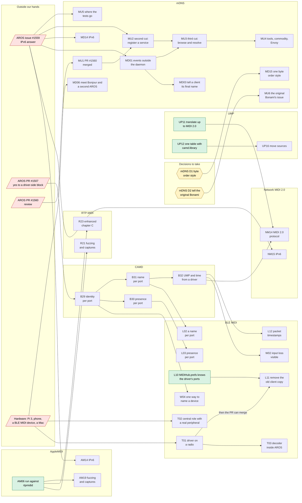

# What depends on what across the backlogs

One graph over the seven lists of work owed:
[CAMD](camd-backlog.md) (B), [RTP-MIDI](rtp-midi-backlog.md) (R),
[AppleMIDI](applemidi-backlog.md) (AM), [UMP](ump-backlog.md) (UP),
[Network MIDI 2.0](network-midi2-backlog.md) (NM),
[BLE MIDI](ble-midi-backlog.md) (L, W, T) and [mDNS](mdns-backlog.md)
(MD, MU). Written on 2026-10-12
from those files; when an item is added, closed or renumbered there, change
it here in the same commit.

An arrow means "has to be done first". Only hard dependencies are drawn: an
item that is merely better done after another is not. Items with no arrow
in or out are not in the picture; they are listed under "Free" below.

## The picture

Green can be started today. Red is not ours to move. Yellow is a decision
that is the project owner's.

## What the graph says

Of 95 open items, 64 have nothing in front of them, 27 sit behind something
outside our hands or behind a decision, and 4 wait only for other work of
ours.

**What opens the most**, counting everything that follows directly or
through other items:

| Do this | It opens | Which is |
|---|---|---|
| A yes in PR #1507 | 10 | B29 to B32, and what BLE MIDI lost to the driver model: names, presence, identity, time |
| Answers in issue #1559 | 9 | Event delivery in mDNS and every cut of it after the first, and the three IPv6 items |
| Hardware | 5 | The test owed to PR #1507, and with it the PR's merge and the removal of the old class here |
| PR #1560 reviewed | 4 | Every later cut of mDNS |

The specification texts, which held 23 items, are in hand since 2026-10-12,
and UMP and Network MIDI 2.0 were read against theirs the same day.

**The longest chains** are in what waits for others: PR #1507, then B29,
B31, B32 and BLE's timestamps; and #1560, then the three further cuts of
mDNS. Within our own hands no chain is longer than two steps any more:
the work that others waited on has been done.

**Four things outside our hands hold most of the 31:**

- *PR #1507* holds CAMD's driver-side block and, behind it, most of what
  BLE MIDI lost. Nothing in RTP-MIDI or AppleMIDI waits for it.
- *Issue #1559* holds mDNS's way upstream after the first cut. It does not
  hold AppleMIDI's use of the service, which can be built on the library in
  this repository.
- *Hardware* holds the one thing we promised a reviewer: T01.
- *PR #1560* holds only mDNS's later cuts.

**mDNS and the transports no longer wait for each other.** What Network
MIDI 2.0 needed of the service to advertise itself (NM08), spaces in a
text record and a time to live from the client, was done on 2026-10-12.

**The decisions** about the drivers were taken by the project owner on
2026-10-12 and the drivers built the same day: a service owns the sockets,
ports go by configuration and then first free, no time crosses a driver
(AppleMIDI backlog D1, D2, D4), and Network MIDI 2.0 has a driver of its
own beside AppleMIDI's (Network MIDI 2.0 backlog D1). Open still: the two
in mDNS, each holding a single item.

## Free: nothing before, nothing after

These can be done in any order and at any time. Their priority comes from
their own backlog, not from this graph.

| Backlog | Items |
|---|---|
| RTP-MIDI | R32, R18, R19, R20, R22, R24, R25, R30 |
| AppleMIDI | AM16, AM27, AM25, AM15, AM20, AM26, AM17, AM18, AM21 |
| UMP | UP06, UP07, UP08, UP13, UP15 |
| Network MIDI 2.0 | NM21, NM22, NM12, NM13, NM17, NM18, NM19 |
| CAMD | B16, B22 |
| BLE MIDI | L01, L06, T04, T06, L05, W03, W05, W06, L15, L09, L04, L07, L14, L16, L17 |
| mDNS | MD20, MD21, MD04, MD05, MD07, MD08, MD09, MD10, MD11, MD12, MD13, MD16, MD17, MD18 |

None of these is a P0 in its own list: the defects in code as it is that
stood free have been closed.

## An order that follows from it

1. Done on 2026-10-12: the P0 defects of RTP-MIDI (R01, R02, R04, R27) and
   of AppleMIDI (AM01 to AM04).
2. **AM06**, the runs against other implementations. The first, against
   node-rtpmidi, was done on 2026-10-12 and found the RS layout defect; rtpmidid
   and Apple's need a machine this one is not.
3. Done on 2026-10-12: AM05, several peers at once.
4. Done on 2026-10-12: AM08 and NM11, the drivers: the runtime as a
   service of the stack, two `DEVS:Midi` drivers it attaches to, and a
   port to each peer; and AM24, the program gone from AROS. Also that
   day: AM09, AM10, AM12 and AM07.
5. Done on 2026-10-12: UP01 and NM01, UMP and Network MIDI 2.0 read
   against their texts, with the corrections they called for.
6. Done on 2026-10-12: Network MIDI 2.0's table of sessions and runtime
   (NM06, NM07). The UMP path runs end to end, on the host and on hosted
   AROS, with our own code at both ends.

7. **BLE MIDI**: T01 the day the hardware is at hand. W01, L08 and L13
   (the codec read against its specification) were done on 2026-10-12.
8. **mDNS**: MD19 was done on 2026-10-12, and with it NM08, Network MIDI
   2.0's discovery, has nothing in front of it. The rest of mDNS's P1 and
   P2 whenever the transports are waiting on something.

CAMD's B16 and B22 fit anywhere. B29 to B32 wait for the maintainer; opening
the issue with the sketch of the driver-side block, which was promised in
PR #1507, is the one step there that is ours.

## Soft dependencies, not drawn

- AM06 is better after R01 and AM01 to AM03: a peer that sends a header we
  reject, or padding we refuse, would fail for reasons already known.
- AM09 can be done now against the `bonami.library` in this repository; its
  final form waits for how service registration enters AROS (issue #1559,
  PR #1560).
- AM03 and AM18 want the counters of R18 to be visible, but can be done
  with their own.
- R11 and R17 were worth doing whichever way D4 goes, and are done.
