# What depends on what across the backlogs

One graph over the seven lists of work owed:
[CAMD](camd-backlog.md) (B), [RTP-MIDI](rtp-midi-backlog.md) (R),
[AppleMIDI](applemidi-backlog.md) (AM), [UMP](ump-backlog.md) (UP),
[Network MIDI 2.0](network-midi2-backlog.md) (NM),
[BLE MIDI](ble-midi-backlog.md) (L, W, T) and [mDNS](mdns-backlog.md)
(MD, MU). Written on 2026-10-12
from those files; when an item is added, closed or renumbered there, change
it here in the same commit.

An arrow means "has to be done first". Only hard dependencies are drawn: an
item that is merely better done after another is not. Items with no arrow
in or out are not in the picture; they are listed under "Free" below.

## The picture

```mermaid
flowchart LR
    classDef outside fill:#fde2e2,stroke:#b42318,color:#000
    classDef decision fill:#fff3c4,stroke:#946200,color:#000
    classDef ready fill:#d9f2e3,stroke:#1a7f4b,color:#000

    subgraph OUT[Outside our hands]
        SPEC[/"Specification texts<br/>M2-104-UM, M2-124-UM"/]:::outside
        I1559[/"AROS issue #1559<br/>IPv6 answer"/]:::outside
        P1507[/"AROS PR #1507<br/>yes to a driver-side block"/]:::outside
        P1560[/"AROS PR #1560<br/>review"/]:::outside
        HW[/"Hardware: Pi 3, phone,<br/>a BLE MIDI device, a Mac"/]:::outside
    end

    subgraph DEC[Decisions to take]
        D1{{"D1 who owns<br/>the sockets"}}:::decision
        D2{{"D2 peers to ports"}}:::decision
        D4{{"D4 no time across<br/>the driver"}}:::decision
        ND1{{"NM D1 one driver<br/>or two"}}:::decision
        MDD1{{"mDNS D1 byte<br/>order style"}}:::decision
        MDD2{{"mDNS D2 tell the<br/>original Bonami"}}:::decision
    end

    subgraph RTP[RTP-MIDI]
        R17["R17 latency<br/>against jitter"]:::ready
        R21["R21 fuzzing<br/>and captures"]
        R23["R23 enhanced<br/>chapter C"]
    end

    subgraph AM[AppleMIDI]
        AM02["AM02 clock object<br/>per peer"]:::ready
        AM05["AM05 several peers<br/>on AROS"]
        AM06["AM06 run against<br/>rtpmidid"]:::ready
        AM07["AM07 who may<br/>connect"]
        AM08["AM08 DEVS:Midi<br/>driver"]
        AM09["AM09 register through<br/>system mDNS"]:::ready
        AM10["AM10 browse<br/>for peers"]
        AM11["AM11 clock<br/>intervals"]
        AM12["AM12 reconnection"]
        AM14["AM14 IPv6"]
        AM15["AM15 table size"]
        AM16["AM16 configuration"]
        AM19["AM19 fuzzing<br/>and captures"]
        AM20["AM20 no command<br/>line"]
    end

    subgraph UMP[UMP]
        UP01["UP01 check against<br/>the text"]
        UP03["UP03 SysEx arrives<br/>in pieces"]:::ready
        UP05["UP05 count what<br/>is dropped"]:::ready
        UP06["UP06 other groups"]
        UPSPEC["UP04 UP07 UP08 UP10<br/>UP13 UP17<br/>rules from the text"]
        UP09["UP09 JR timestamps"]
        UP11["UP11 translate up<br/>to MIDI 2.0"]
        UP12["UP12 one table with<br/>camd.library"]
        UP16["UP16 move sources"]
    end

    subgraph NM[Network MIDI 2.0]
        NM01["NM01 check against<br/>the text"]
        NM02["NM02 session knows<br/>its peer"]:::ready
        NMSPEC["NM05 NM12 NM20<br/>rules from the text"]
        NM04["NM04 act on a<br/>long loss"]
        NM06["NM06 table of<br/>sessions"]
        NM07["NM07 a runtime"]
        NM08["NM08 discovery"]
        NM09["NM09 timed delivery"]
        NM10["NM10 run against<br/>another implementation"]
        NM11["NM11 reach CAMD<br/>through a driver"]
        NM13["NM13 retransmission"]
        NM14["NM14 MIDI 2.0<br/>protocol"]
        NM15["NM15 IPv6"]
        NM16["NM16 ping identifier"]
        NM17["NM17 vectors, fuzzing,<br/>captures"]
    end

    subgraph CAMD[CAMD]
        B29["B29 identity<br/>per port"]
        B30["B30 presence<br/>per port"]
        B31["B31 name<br/>per port"]
        B32["B32 UMP and time<br/>from a driver"]
    end

    subgraph BLE[BLE MIDI]
        T01["T01 driver on<br/>a radio"]
        T02["T02 central role with<br/>a real peripheral"]
        T03["T03 decoder<br/>inside AROS"]
        L10["L10 MIDIHub.prefs knows<br/>the driver's ports"]:::ready
        L11["L11 remove the<br/>old client copy"]
        L02["L02 a name<br/>per port"]
        L03["L03 presence<br/>per port"]
        W04["W04 one way to<br/>name a device"]
        W02["W02 input loss<br/>visible"]
        L12["L12 packet<br/>timestamps"]
    end

    subgraph MDNS[mDNS]
        MD01["MD01 events outside<br/>the daemon"]
        MD02["MD02 spaces in<br/>text records"]:::ready
        MD03["MD03 tell a client<br/>its final name"]
        MD06["MD06 meet Bonjour and<br/>a second AROS"]
        MD14["MD14 IPv6"]
        MD15["MD15 one byte<br/>order style"]
        MU1["MU1 PR #1560<br/>merged"]
        MU2["MU2 second cut:<br/>register a service"]
        MU3["MU3 third cut:<br/>browse and resolve"]
        MU4["MU4 tools, commodity,<br/>Envoy"]
        MU5["MU5 where the<br/>tests go"]
        MU6["MU6 the original<br/>Bonami's issue"]
    end

    AM06 --> R21
    AM06 --> R23
    AM06 --> AM19

    AM02 --> AM05
    AM02 --> AM11
    AM05 --> AM07
    AM05 --> AM08
    AM05 --> AM12
    AM05 --> AM15
    AM07 --> AM16
    R17 --> AM16
    AM09 --> AM10
    AM10 --> AM12
    AM08 --> AM20
    D1 --> AM08
    D2 --> AM08
    D4 --> AM08
    D2 --> AM16
    I1559 --> AM14
    I1559 --> NM15

    SPEC --> UP01
    SPEC --> NM01
    UP01 --> UPSPEC
    UP01 --> UP09
    UP01 --> UP11
    UP01 --> UP12
    UP12 --> UP16
    UP05 --> UP06

    NM01 --> NMSPEC
    NM01 --> NM04
    NM04 --> NM13
    NM02 --> NM06
    NM02 --> NM16
    NM06 --> NM07
    AM05 --> NM07
    NM07 --> NM08
    AM10 --> NM08
    NM07 --> NM09
    UP09 --> NM09
    R17 --> NM09
    NM07 --> NM10
    NM10 --> NM17
    NM01 --> NM17
    NM07 --> NM11
    AM08 --> NM11
    UP03 --> NM11
    ND1 --> NM11
    UP11 --> NM14
    B32 --> NM14

    HW --> T01
    HW --> T02
    HW --> MD06
    T01 --> T03
    T01 -- "then the PR can merge" --> L11
    L10 --> L11
    B31 --> L02
    B30 --> L03
    B29 --> W04
    B32 --> W02
    B32 --> L12

    I1559 --> MD01
    I1559 --> MD14
    I1559 --> MU2
    I1559 --> MU5
    MD01 --> MD03
    MD01 --> MU3
    MD02 --> NM08
    MDD1 --> MD15
    MDD2 --> MU6
    P1560 --> MU1
    MU1 --> MU2
    MU2 --> MU3
    MU3 --> MU4

    P1507 --> B29
    B29 --> B30
    B29 --> B31
    B31 --> B32
    UP01 --> B32
```

Green can be started today. Red is not ours to move. Yellow is a decision
that is the project owner's.

## What the graph says

Of 120 open items, 55 have nothing in front of them, 50 sit behind something
outside our hands or behind a decision, and 15 wait only for other work of
ours.

**What opens the most**, counting everything that follows directly or
through other items:

| Do this | It opens | Which is |
|---|---|---|
| Have the specification texts | 23 | All of UMP's and Network MIDI 2.0's conformance work, CAMD's B32, and through it BLE's timestamps |
| UP01, check UMP against the text | 15 | The rest of UMP, B32, timed delivery and the MIDI 2.0 protocol over the network |
| AM02, the clock object | 14 | Several peers, and through them the driver, the accept rule, reconnection, configuration, and Network MIDI 2.0's whole runtime |
| AM05, several peers on AROS | 12 | The same as AM02 less the clock intervals |
| A yes in PR #1507 | 10 | B29 to B32, and what BLE MIDI lost to the driver model: names, presence, identity, time |
| Answers in issue #1559 | 9 | Event delivery in mDNS and every cut of it after the first, and the three IPv6 items |
| NM02, the session knows its peer | 8 | The session table, the runtime and everything run on it |
| Hardware | 5 | The test owed to PR #1507, and with it the PR's merge and the removal of the old class here |
| D2, peers to ports | 4 | The driver, configuration, and Network MIDI 2.0's way into CAMD |
| PR #1560 reviewed | 4 | Every later cut of mDNS |

**The longest chains** are four steps of our own work after something
outside: the texts, UP01, B32 and then BLE's timestamps; and #1560, then
the three further cuts of mDNS. Within our own hands the longest is
AM02 → AM05 → NM07 → NM10 → NM17, from AppleMIDI into Network MIDI 2.0,
which is why AppleMIDI goes first.

**Five things outside our hands hold most of the 50:**

- *The specification texts* hold the most and cost the least to get: they
  are documents to obtain and read, not answers to wait for.
- *PR #1507* holds CAMD's driver-side block and, behind it, most of what
  BLE MIDI lost. Nothing in RTP-MIDI or AppleMIDI waits for it.
- *Issue #1559* holds mDNS's way upstream after the first cut. It does not
  hold AppleMIDI's use of the service, which can be built on the library in
  this repository.
- *Hardware* holds the one thing we promised a reviewer: T01.
- *PR #1560* holds only mDNS's later cuts.

**mDNS and the transports meet in one place.** MD02, spaces in a text
record, has to be done before Network MIDI 2.0 can advertise itself (NM08).
Everything else in mDNS is independent of the MIDI work, and the reverse.

**The decisions** hold little now. D1, D2 and D4 are needed by one item,
the driver (AM08), three steps into AppleMIDI. The two in mDNS each hold a
single item.

## Free: nothing before, nothing after

These can be done in any order and at any time. Their priority comes from
their own backlog, not from this graph.

| Backlog | Items |
|---|---|
| RTP-MIDI | R11, R14, R18, R19, R20, R22, R24, R25 |
| AppleMIDI | AM01, AM03, AM04, AM13, AM17, AM18, AM21 |
| UMP | UP02, UP14, UP15 |
| Network MIDI 2.0 | NM03, NM18, NM19 |
| CAMD | B16, B22 |
| BLE MIDI | L01, L06, T04, T06, L05, W03, W05, W06, L09, L04, L07 |
| mDNS | MD04, MD05, MD07, MD08, MD09, MD10, MD11, MD12, MD13, MD16, MD17, MD18 |

AM01, AM03, AM04, UP02 and NM03 are P0 in their own
lists: defects in code as it is. That they open nothing else is no reason to leave them.

## An order that follows from it

1. **The P0 defects that are free**, on portable code with host tests:
   AM01, AM03, AM04. RTP-MIDI's (R01, R02, R04, R27) were done on
   2026-10-12.
2. **AM02**, the clock object, because of what it opens; then **AM06**, the
   run against rtpmidid, before building further on code that has met no
   other implementation.
3. **AM05**, several peers. Here the driver's decisions (D1, D2, D4) become
   due.
4. **AM08**, the driver, and **AM09**/**AM10**, discovery through the system
   service.
5. In parallel with any of the above, whenever the texts are at hand:
   **UP01** and **NM01**. They are reading, they need nothing from AROS, and
   between them they open a quarter of everything here.
6. **Network MIDI 2.0's runtime** (NM02, NM06, NM07) after step 3.

7. **BLE MIDI**: T01 the day the hardware is at hand. W01 and L08 were done
   on 2026-10-12.
8. **mDNS**: MD02 before step 6 reaches discovery; the rest of its P1 and P2
   whenever the transports are waiting on something.

CAMD's B16 and B22 fit anywhere. B29 to B32 wait for the maintainer; opening
the issue with the sketch of the driver-side block, which was promised in
PR #1507, is the one step there that is ours.

## Soft dependencies, not drawn

- AM06 is better after R01 and AM01 to AM03: a peer that sends a header we
  reject, or padding we refuse, would fail for reasons already known.
- AM09 can be done now against the `bonami.library` in this repository; its
  final form waits for how service registration enters AROS (issue #1559,
  PR #1560).
- AM03 and AM18 want the counters of R18 to be visible, but can be done
  with their own.
- R11 and R17 are worth doing whichever way D4 goes.
