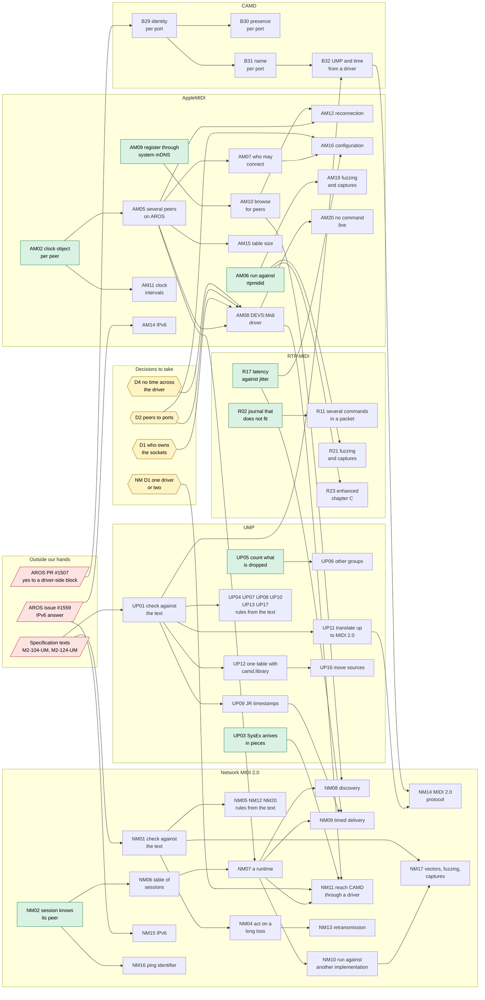

# What depends on what across the backlogs

One graph over the five lists of work owed:
[CAMD](camd-backlog.md) (B), [RTP-MIDI](rtp-midi-backlog.md) (R),
[AppleMIDI](applemidi-backlog.md) (AM), [UMP](ump-backlog.md) (UP) and
[Network MIDI 2.0](network-midi2-backlog.md) (NM). Written on 2026-10-12
from those files; when an item is added, closed or renumbered there, change
it here in the same commit.

An arrow means "has to be done first". Only hard dependencies are drawn: an
item that is merely better done after another is not. Items with no arrow
in or out are not in the picture; they are listed under "Free" below.

## The picture

Green can be started today. Red is not ours to move. Yellow is a decision
that is the project owner's.

## What the graph says

Of 78 open items, 32 have nothing in front of them, 30 sit behind something
outside our hands or behind a decision, and 16 wait only for other work of
ours.

**What opens the most**, counting everything that follows directly or
through other items:

| Do this | It opens | Which is |
|---|---|---|
| Have the specification texts | 21 | All of UMP's and Network MIDI 2.0's conformance work, and CAMD's B32 |
| AM02, the clock object | 14 | Several peers, and through them the driver, the accept rule, reconnection, configuration, and Network MIDI 2.0's whole runtime |
| UP01, check UMP against the text | 13 | The rest of UMP, B32, timed delivery and the MIDI 2.0 protocol over the network |
| AM05, several peers on AROS | 12 | The same as AM02 less the clock intervals |
| NM02, the session knows its peer | 8 | The session table, the runtime and everything run on it |
| A yes in PR #1507 | 5 | B29 to B32 and, last, the MIDI 2.0 protocol over the network |
| D2, peers to ports | 4 | The driver, configuration, and Network MIDI 2.0's way into CAMD |

**The longest chain of our own work** is five steps:
AM02 → AM05 → NM07 → NM10 → NM17. It starts in AppleMIDI and ends in
Network MIDI 2.0, which is why AppleMIDI goes first: its runtime is the one
the other transport is built beside.

**Three things outside our hands hold the rest:**

- *The specification texts* hold the most and cost the least to get: they
  are documents to obtain and read, not answers to wait for.
- *PR #1507* holds only CAMD's driver-side block. Nothing in RTP-MIDI or
  AppleMIDI waits for it.
- *Issue #1559* holds only the two IPv6 items.

**The decisions** hold little now and much later. D1, D2 and D4 are needed
by one item, the driver (AM08), and that item is three steps into
AppleMIDI. They can wait until AM05 is done without delaying anything.

## Free: nothing before, nothing after

These can be done in any order and at any time. Their priority comes from
their own backlog, not from this graph.

| Backlog | Items |
|---|---|
| RTP-MIDI | R01, R04, R14, R18, R19, R20, R22, R24, R25 |
| AppleMIDI | AM01, AM03, AM04, AM13, AM17, AM18, AM21 |
| UMP | UP02, UP14, UP15 |
| Network MIDI 2.0 | NM03, NM18, NM19 |
| CAMD | B16, B22 |

R01, R04, AM01, AM03, AM04, UP02 and NM03 are P0 in their own lists: defects
in code as it is. That they open nothing else is no reason to leave them.

## An order that follows from it

1. **The P0 defects that are free**, on portable code with host tests: R01,
   R02, R04, then AM01, AM03, AM04.
2. **AM02**, the clock object, because of what it opens; then **AM06**, the
   run against rtpmidid, before building further on code that has met no
   other implementation.
3. **AM05**, several peers. Here the driver's decisions (D1, D2, D4) become
   due.
4. **AM08**, the driver, and **AM09**/**AM10**, discovery through the system
   service.
5. In parallel with any of the above, whenever the texts are at hand:
   **UP01** and **NM01**. They are reading, they need nothing from AROS, and
   between them they open a quarter of everything here.
6. **Network MIDI 2.0's runtime** (NM02, NM06, NM07) after step 3.

CAMD's B16 and B22 fit anywhere. B29 to B32 wait for the maintainer; opening
the issue with the sketch of the driver-side block, which was promised in
PR #1507, is the one step there that is ours.

## Soft dependencies, not drawn

- AM06 is better after R01 and AM01 to AM03: a peer that sends a header we
  reject, or padding we refuse, would fail for reasons already known.
- AM09 can be done now against the `bonami.library` in this repository; its
  final form waits for how service registration enters AROS (issue #1559,
  PR #1560).
- AM03 and AM18 want the counters of R18 to be visible, but can be done
  with their own.
- R11 and R17 are worth doing whichever way D4 goes.
