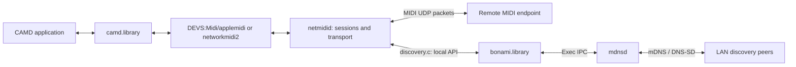

# Network MIDI discovery: standards, Bonami API and audit findings

**Follow-up:** [#1591 review fixes and validation](bonami-review-followup-2026-10-18.md)
update the registration slice. The local browse/resolve implementation remains
separate and its callback-delivery findings remain open.

Review date: 2026-10-17. This continues the [upstream audit](aros-upstream-review.md).
The five open PR heads were rechecked on GitHub and are unchanged from the
[first pass](aros-upstream-review-2026-10-17.md). The local implementation
examined is MIDIHub `897eb224703e2dc8cb62a2edd1a0632bbd557401`; no production
source was changed for this review.

**Owner's priority clarification:** functional conformance of the open PRs
comes first. Bonami is the proposed implementation, with no maintainer
acceptance of its API/name/architecture assumed. Its conventions are evidence
to audit, not requirements to preserve. Apply the
[open-PR contract matrix](aros-upstream-review.md#review-priority-clarified-by-the-project-owner)
when prioritizing findings; local browse features do not expand #1591's scope.

## The protocols and the implementation are different contracts

**mDNS** transports DNS questions/answers on the local link, using UDP 5353,
IPv4 multicast `224.0.0.251` or IPv6 `ff02::fb`. It governs probing, conflicts,
response timing, cache expiry and withdrawal. A record TTL is a cache lifetime,
not a MIDI session timeout or IP packet TTL. [RFC 6762](https://www.rfc-editor.org/rfc/rfc6762.html)

**DNS-SD** describes services using PTR (instances), SRV (target/port), TXT
(attributes) and host address records. Dots can occur inside an instance's
single DNS label; TXT keys compare without ASCII case sensitivity. TXT on
the wire is length-prefixed strings, not a shell-style line with escapes.
[RFC 6763 §§4–6](https://www.rfc-editor.org/rfc/rfc6763.html)

**MIDI profiles** supply service types and MIDI-specific metadata:

| Transport | Advertised service | What the announcement identifies |
|---|---|---|
| AppleMIDI | `_apple-midi._udp.local.` | Control UDP port N; MIDI data uses N+1 |
| Network MIDI 2.0 | `_midi2._udp.local.` | Host UDP port, `UMPEndpointName`, `ProductInstanceId` |

The first mapping is Apple's protocol, not a Bonami invention.
[Apple MIDI Network Driver Protocol](https://developer.apple.com/library/archive/documentation/Audio/Conceptual/MIDINetworkDriverProtocol/MIDI/MIDI.html)
Network MIDI 2.0 discovery is optional; direct address/port sessions are
supported. If discovery is enabled, its profile uses mDNS/DNS-SD. Its endpoint
name allows 98 UTF-8 bytes, product ID 42 printable ASCII bytes; service TTL
should be at most 60 seconds. These are MIDI profile rules, not Bonami rules.
[M2-124-UM v1.0 §§3–4](https://amei-music.github.io/midi2.0-docs/amei-pdf/M2-124-UM_v1-0_Network-MIDI-2-0-UDP.pdf)

**Bonami** is a client API and implementation of these facilities on Amiga/AROS.
RFCs do not prescribe an Amiga library name, vectors, tags, hooks, task owners,
handles, message ports, or a daemon. Those choices need their own API/lifetime
review. Bonjour and Avahi likewise expose implementation-specific APIs for
standard discovery concepts.

## What actually calls Bonami



`ports/aros/netmidi/netmididriver.c` has no Bonami, DNS or socket calls.
It exchanges MIDI bytes with the service through adapters. Portable RTP-MIDI,
UMP and Network MIDI 2.0 libraries do not call Bonami either. The local dependency
is in `ports/aros/midihub/discovery.c`, used by `main.c`.

The caller currently uses exactly these operations:

| Call | Use in the MIDI service | Delivery stage |
|---|---|---|
| `OpenLibrary("bonami.library", 40)` | Obtain client library | N8/N9 |
| `OpenMDNSEngine()` | Check whether daemon is available | N8/N9 |
| `RegisterServiceA()` | Publish AppleMIDI; publish MIDI 2.0 when enabled | N8/N9 |
| `DeregisterService()` | Withdraw publication | N8/N9 |
| `CloseMDNSEngine()` | Release this task's operations, not stop system daemon | N8/N9 |
| `BrowseServiceTypeA()` | Find AppleMIDI peers; MIDI 2.0 Hosts when configured by name | N9 |
| `StopBrowse()` | Stop delivery before freeing callback storage | N9 |
| `CloseLibrary()` | Release library | N8/N9 |

Registration supplies name, type, port and handle-output tags. MIDI 2.0 adds
TXT and `MDNS_TimeToLive=60`. Browse supplies a hook and handle-output tag.
The hook gets a snapshot with name, IPv4 address, port and TXT; the service
filters unresolved snapshots and copies events into its ring.

It does **not** call `UpdateServiceA`, `ResolveServiceA`, `LookupHostA`,
`QueryRecordA`, `MakeTXTRecordA`, status APIs, Envoy/NIPC APIs or the commodity.
Current browsing relies on Bonami automatically filling resolution data into
later ADD snapshots; a differently shaped API could expose resolution separately.

`main.c:1514–1544` selects a MIDI 2.0 Host by endpoint or instance name and
forms its session key from IPv4 address/port. The publication includes
`ProductInstanceId`; discovery events do not retain it for persistent peer
selection. Pair-based identity/reconnection remains future functionality,
not an implemented guarantee.

## Which Bonami choices are specific to the implementation

| Choice | Origin/meaning | Assessment for MIDI |
|---|---|---|
| Library names, vectors, TagItems, opaque references | Bonami API/ABI | Mechanism; not a network requirement |
| `OpenMDNSEngine` / `CloseMDNSEngine` | Inherited names with AROS lifecycle changes | The names conceal different availability/release operations; document explicitly |
| One externally managed daemon | AROS adaptation; original engine ran inside library | Coherent system integration; not mandated by an RFC |
| Escaped space-separated TXT string | Bonami textual representation, extended by AROS MD02 | Standard strings are emitted, but representation needs correct bounds and decoding |
| `MDNS_TimeToLive` | AROS API addition exposing record TTL | Used to express the MIDI 2.0 profile's shorter lifetime |
| Client hooks executed by daemon | Inherited event mechanism | Not required by DNS-SD; MD01 already identifies isolation/lifetime problems |
| Task-pointer ownership and periodic task scans | AROS cleanup policy | Not a protocol feature; BA-001/BA-003 remain relevant |
| Fixed arrays and one IPv4 address per snapshot | Implementation limits | Need explicit capability limits and lossless supported MIDI data |
| Envoy bridge, tools and commodity | Optional surrounding features | No dependency from the MIDI service |

Original Bonami compatibility is already described as **not a constraint** in
[the mDNS backlog](mdns-backlog.md). Keep or change an API based on AROS needs;
there is no standards reason to reproduce every Bonami facility.

## Reproduced findings

### BA-007 — DNS label boundaries are lost (Bonami; medium; #1591)

Pinned code: `24f476235e7ed6babaad84a44e90242948a029f9`,
`workbench/network/mdns/mdns_dns.c`, `mdnsWireToName()` / `mdnsNameToWire()`;
`mdns_reg.c`, `instance_fqdn()` and `service_append()`.

An actual wire label `Studio.1` decodes to `Studio.1._midi2._udp.local`.
Encoding that string again yields first label `Studio`, changing its identity.
The unescaped concatenation in registration has the same ambiguity. Local
browse also splits names at the first dot. This affects ordinary valid names,
not just malformed traffic.

**Evidence:** host test against exact PR helpers: first label length 8 becomes
6. **Fix direction:** preserve structured labels internally or use reversible
DNS presentation escaping in every encoder, decoder and splitting caller.
Do not patch only display text. Add registration/browse tests for literal dots,
backslashes and ordinary names on the wire. Native network test not run here.

### DI-001 — successful discovery never notices daemon restart (Drivers; high for discovery; local N8/N9)

`ports/aros/midihub/discovery.c`, `netmidi_discovery_poll():210–230` returns
early when there are no pending handles. Once registration and searches
succeed, it performs no further library calls. A new daemon has lost those
operations, while the service retains non-NULL references and reports success.

**Evidence:** actual integration source, mocked daemon registry reset, then a
poll after 20 seconds: `reported=1, registrations=0, searches=0, library calls=0`.
This concerns a daemon process restart. A stack reconfiguration that keeps
mdnsd alive and preserves its registry is a different lifecycle path.
**Fix direction:** define daemon incarnation/operation validity and recovery,
including browse resubscription and safe stale-event teardown. Merely checking
whether a daemon exists cannot detect a stop/restart between polls. Coordinate
with BA-006 handle reuse. Native stop/restart test still required.

### DI-002 — TXT key lookup is case-sensitive (Drivers; medium; local N9)

`discovery.c`, `browse_hook():154–187` compares `UMPEndpointName=` byte for
byte. A snapshot containing `umpendpointname=Piano` produces an empty endpoint.
**Evidence:** actual callback, mocked resolved snapshot; canonical spelling
with escaped spaces passes, lowercase spelling fails. **Fix direction:**
ASCII-insensitive key comparison, preserving case in values. Retain the first
matching key and reject/ignore malformed data deliberately. Packet-to-client
integration still needs a test.

### DI-003 — valid endpoint names are truncated (Drivers; medium; local N9)

`discovery.h`, `struct netmidi_discovered.endpoint[64]`; `browse_hook()`.
**Evidence:** a 98-byte endpoint value becomes 63 bytes in the event.
This can also merge distinct names sharing a prefix. `midi2_wanted` in
`main.c` and `midi2_peer_name` / MIDI 2.0 port names in `config.h` also use
64-byte arrays. The portable codec already uses `NETMIDI2_NAME_MAX=98`.
**Fix direction:** carry full endpoint names throughout selection/configuration;
keep DNS instance-label limits separate from MIDI endpoint-name limits. Include
UTF-8 boundary cases and names with a shared 63-byte prefix.

### BA-008 — escaped TXT expansion drops valid metadata (Bonami; medium; local M3, related #1591 API bound)

`network/mdns/aros/src/mdns_dns.c`, `mdnsTxtAppend()`;
`mdns_browse.c:631–650`; public `MDNS_MAX_TXT=256`.
**Evidence:** two supported MIDI fields with printable backslashes need only
176 wire bytes but 315 bytes in the escaped representation. Appending the
second field fails; the browse conversion stops and exposes partial metadata.
The pinned #1591 registration API also has the fixed escaped-string bound;
its `copy_text()` truncates rather than reporting overlength. The executed
test covers the local receive conversion, not the complete #1591 IPC path.

**Fix direction:** size the API for worst-case supported expansion or expose
counted TXT items/wire data with explicit lengths. Do not silently accept a
partial record. Broader arbitrary-binary TXT support is an additional generic
DNS-SD API question; the reproduced MIDI strings contain no binary NULs.

## Additional source finding and protocol checks still needed

**BA-009 — long PTR targets are truncated before splitting (Bonami; medium;
local M3, not #1591's register-only code).** In `mdns_browse.c:505–515`, the
entire PTR target is first copied into a 65-byte instance buffer, then split
into instance/type. A 63-byte instance leaves the dot at position 63 and no
type text after it. Its PTR is indexed with an empty type; SRV/TXT processing
uses the full owner and a different cache key. Split the complete structured
name before copying bounded components. Source-confirmed data-flow issue;
no execution of the cache/notification path in this pass.

Also verify per-record SRV/TXT/A expiry and cache-flush handling independently
from PTR presence. The local cache uses `ce_Expire` refreshed by PTR and a
fixed browse backoff up to 60 seconds. It needs a sustained test with short
service TTLs, packet loss, address/port changes and clean/abrupt disappearance.
No timing-failure claim is made from inspection alone. RFC cache refresh and
withdrawal rules are the acceptance reference, not Bonami's current loop.

## Scope and delivery decisions

- **N1 / #1586 drivers and #1587/#1588 codecs:** no direct Bonami dependency.
  Do not block their independent code reviews on unused discovery APIs.
- **N8 advertisement:** needs M2/#1591 register-only facilities. BA-007 affects
  that PR; previous lifecycle findings remain open.
- **N9 browse by name:** also needs M3's browse/resolution and a safe event
  contract. DI-001–003, BA-008–009 and MD01 must be addressed before claiming
  reliable automatic discovery.
- **Direct address/port operation:** does not require discovery. Lack of
  discovery need not prevent transport-only delivery or validation.

The [current issue #1559](https://github.com/aros-development-team/AROS/issues/1559)
still has no maintainer answer about event delivery. Its latest author update
explicitly defers M3 until that decision. The current #1591 has no browse
callbacks, comments or reviews. Do not attribute the local hook implementation
to the register-only PR, or treat either proposed replacement API as approved.

My recommendation for the eventual AROS interface is a small registration and
resolved-event contract with explicit ownership/cancellation and daemon restart
semantics. Whether those events use a client port or a library dispatcher is
an architectural decision; the standards do not settle it. No new public ABI
or production implementation was introduced in this audit.

## Reproduction

```sh
rtk proxy python3 tools/review-mdns-contract.py --aros-tree /home/jaime/AROS-net
```

Seven cases run under ASan/UBSan: two baseline passes (spaces in the actual
callback and unescaped wire TXT item), five semantic failures (case, 98-byte
endpoint, restart, literal-dot labels and TXT expansion). The exit status is
1 while failures remain; individual logs are in `build/mdns-review/<commit>/`.

The adapter tests compile actual `discovery.c` with mocked library state;
the wire tests compile exact #1591 DNS helpers; TXT expansion compiles the
local port's helper. The host shim supplies types and no-op scheduling calls.
It is **not** an AROS ABI, IPC, SMP, packet-capture or independent peer test.
No new native/hardware/interoperability results are claimed.
