# Pull requests from what there is, in an order that keeps upstream building

**2026-10-21 transport refactor:** [netmidid is now a core and
transports](netmidid-transports-2026-10-21.md). Over N4, N7 adds a new
`transport_midi2.c` and one line to the core instead of 476 lines in
`main.c`; each transport also has its own configuration keys and
state, so N7 only adds files and one-line hooks. The local cuts changed; the published #1679, #1693, #1742 and
#1743 branches did not, and wait for the owner's decision.

**2026-10-20 publication update:** [#1742 adds NetMIDIStatus and #1743 adds
AppleMIDI advertisement](network-midi-status-advertisement-2026-10-20.md).
Both are drafts depending only on the open #1679 service; #1591 is merged.
The advertisement slice excludes MIDI 2.0 and browse/resolve, so neither
new PR depends on #1693 or #1695. Their GitHub checks pass.
[Fresh Avahi discovery now passes](mdns-advertisement-avahi-2026-10-20.md),
including late startup, daemon restart, rediscovery and withdrawal. The
previous gap came from the test browser terminating after its initial list.

**2026-10-20 service/review update:** [#1678 is merged, #1679 is ready for
review, and the CAMD review fixes were published](camd-maintainer-review-2026-10-20.md).
#1693 remains draft pending #1679; #1695 is ready for review. The dated
entries below describe earlier publication stages.

**2026-10-18 discovery update:** [#1695 is a dependent draft for browse and
asynchronous resolve](mdns-discovery-followup-2026-10-18.md), proposing client
polling. It depends on #1591 and event-API review in #1559. N9 consumer adoption,
generic lookup/query and local-service reflection remain separate work.

**2026-10-18 Network MIDI 2.0 update:** [#1692 corrects the library;
#1693 is the dependent N7 service draft](network-midi2-publication-2026-10-18.md).
The #1679 parent and generation templates also follow upstream's later
move of the shared driver source/header into `camd/networkmidi2`.

**2026-10-18 readiness update:** #1586, #1587 and #1588 are merged.
[#1678 is rebased and ready for review; #1679 is rebased and remains
a dependent draft](upstream-sessions-ready-2026-10-18.md).

**2026-10-17 publication update:** [#1678 (N3) and #1679 (N4) are now
dependent drafts](upstream-publication-2026-10-17.md). The same record covers
the #1587 correction and separate #1676/#1677 cleanup fixes. The dated
preparation history below remains useful for scope and dependencies.

What of this repository could be sent to `aros-development-team/AROS`, cut
into pull requests, and which has to be merged before which so that
upstream `master` builds after every one of them. Written on 2026-10-12.
It is the companion of [the backlog graph](backlog-dependencies.md): that
one orders the work, this one orders the sending. The record of what was
sent and how it went is in [upstream pull requests](upstream-prs.md).

**The rule.** A pull request builds alone on upstream `master` as it is
that day: every header it includes and every library it links is already
there, or is in the same pull request. An arrow below means "has to be
merged first, or this one does not compile". A dotted arrow means it
compiles without, but is of no use or was not what the reviewer asked for.

**How far this was checked.** The dependencies are read from each source's
`#include` lines and from `mmakefile.src`. All of it builds and runs on
hosted x86-64 in `~/AROS`, which is upstream `master` of 2026-10-11 **with
this repository's CAMD patches applied and the whole package present**.
None of the cuts below has been built in a clean upstream worktree yet;
that is the first step of each, and the reason for the node PREP-3.

## The picture

```mermaid
flowchart TD
    classDef there fill:#d9f2e3,stroke:#1a7f4b,color:#000
    classDef open fill:#dbeafe,stroke:#1d4ed8,color:#000
    classDef outside fill:#fde2e2,stroke:#b42318,color:#000
    classDef prep fill:#fff3c4,stroke:#946200,color:#000

    subgraph UP[Already in upstream master]
        U_CAMD["camd.library and its<br/>driver interface"]:::there
        U_BT["Bluetooth LE stack<br/>(#1506)"]:::there
        U_NET["AROSTCP multicast<br/>(#1543, #1558)"]:::there
        U_SVC["AROSTCP service manager,<br/>db/services.d"]:::there
        U_ENT["entropy.resource"]:::there
    end

    subgraph OUT[Not ours to move]
        REV1507[/"review and radio test<br/>of #1507"/]:::outside
        I1559[/"answers in issue #1559"/]:::outside
        CAMDQ[/"the maintainer's yes to a<br/>driver-side block in CAMD"/]:::outside
    end

    subgraph PREP[To do here before anything network MIDI is sent]
        PREP1["PREP-1 carve the sources:<br/>no package name, no Linux harness"]:::prep
        PREP2["PREP-2 the Codacy gate:<br/>strcpy, strlen, late declarations"]:::prep
        PREP3["PREP-3 build each cut in a clean<br/>worktree; run on unpatched CAMD"]:::prep
    end

    subgraph BT[Bluetooth MIDI]
        P1507["#1507 btmidi.class<br/>(open)"]:::open
    end

    subgraph MDNS[mDNS]
        P1560["#1560 mdnsd, the<br/>host's name (merged)"]:::there
        M2["M2 #1591 the library:<br/>register a service (open)"]:::open
        M3["M3 browse, resolve,<br/>lookup, queries"]
        M4["M4 tools, commodity,<br/>Envoy bridge"]
    end

    subgraph NETMIDI[Network MIDI]
        N1["N1 the two CAMD drivers:<br/>applemidi, networkmidi2"]
        N2["N2 RTP-MIDI payload<br/>and journal"]
        N3["N3 AppleMIDI sessions,<br/>peers, ports, clock"]
        N4["N4 the service netmidid,<br/>peers by address"]
        N5["N5 NetMIDIStatus"]
        N6["N6 UMP and Network<br/>MIDI 2.0 codecs"]
        N7["N7 Network MIDI 2.0<br/>in the service"]
        N8["N8 the service is<br/>advertised"]
        N9["N9 the service finds<br/>peers by name"]
    end

    subgraph CAMDX[CAMD]
        C0["C0 a driver is found<br/>at an aligned address"]
        C1["C1 driver-side block:<br/>identity, presence, name"]
    end

    U_BT --> P1507
    U_CAMD --> P1507
    REV1507 --> P1507

    U_NET --> P1560
    U_SVC --> P1560
    P1560 --> M2
    I1559 --> M2
    M2 --> M3
    I1559 --> M3
    M3 --> M4

    PREP1 --> N1
    PREP3 --> N1
    U_CAMD --> N1
    U_CAMD --> C0
    C0 -. "or no port appears" .-> N1
    C0 -.-> P1507
    PREP1 --> N2
    PREP2 --> N2
    N2 --> N3
    N1 --> N4
    N3 --> N4
    U_SVC --> N4
    U_ENT --> N4
    U_NET --> N4
    N4 --> N5
    PREP2 --> N6
    N4 --> N7
    N6 --> N7
    N4 --> N8
    M2 --> N8
    N8 --> N9
    M3 --> N9

    CAMDQ --> C1
    N1 -.-> C1
    P1507 -.-> C1
```

Green is in upstream. Blue is open there now. Red is somebody else's
answer. Yellow is work to do here first. The rest are pull requests not
yet cut.

## What each one is

Lines are of today's sources, tests not counted; a carved cut will be
somewhat smaller.

| | What goes in | Lines | Needs merged first | Waits for |
|---|---|---|---|---|
| **#1507** | `btmidi.class` and its driver stub. Three commits are local in `~/AROS-btmidi` and not pushed: the adapter's version and whole-packet check are pushed; the codec's citations with the reserved header bit, and F9/FD left out, are not. | — | Nothing: the stack is merged | The radio test promised in the PR (T01), then the review |
| **#1560** | `mdnsd` answering for the host's name. | 1,600 | Nothing | Nothing: merged 2026-10-13 |
| **M2** | `bonami.library` and the daemon's side of registering, updating and withdrawing a service, with the text record's escaping (MD02) and the time to live (MD19). **Sent as #1591** from the branch `mdns-register` (`~/AROS-net`), one commit on upstream `master`. | 2,160 | #1560 (merged) | Where it lives, how it is split and what the library is called: issue #1559 |
| **M3** | Browse, resolve, host lookup, queries; a client's own records answered (MD04). | about 3,000 | M2 | How clients get events: issue #1559, and MD01 here |
| **M4** | `dnssd` and the other tools, the commodity, the Envoy bridge. | about 2,500 | M3 | Whether AROS wants them |
| **C0** | One change to `OpenMidiDevice()`, seventeen lines: a driver's `MidiDeviceData` is looked for at aligned addresses. It is a defect of upstream's own and not about our drivers: on hosted x86-64, upstream's `camd.library` finds **no** driver in `DEVS:Midi`, its own `debugdriver` and `hostmidi` among them; a program listing the clusters sees none, and with the change sees all of them (seen in the clean tree on 2026-10-12, with CAMD built both ways). **Cut**: branch `camd-driver-scan-align` in `~/AROS-netmidi`, one commit on upstream `master` (it is `patches/aros-camd-driver-scan-align.patch` here). | 17 | Nothing | — |
| **N1** | `netmididriver.c` built twice and the adapters' header: two `DEVS:Midi` drivers of sixteen ports and no network code. **Cut** on 2026-10-12: `tools/cut-netmidi-drivers.sh` writes it into an AROS tree as `workbench/devs/camd/common`, and the branch `netmidi-drivers` in the worktree `~/AROS-netmidi` is upstream `master` with it and nothing else. Built by its own targets for hosted x86-64 and amiga-m68k; of the 126 headers it pulls in, none is one this repository changes. | 380 | Nothing to compile: it includes `proto/exec.h` and `midi/camddevices.h` only. **To be of any use, C0**: seen on 2026-10-12 | — |
| **N2** | `rtpmidi.c`, `sender.c`, `receiver.c`, `timing.c` and their headers, as the link library `rtpmidi`. **Cut** on 2026-10-12: `tools/cut-netmidi-library.sh n2` writes it as `workbench/network/netmidid/rtpmidi`. It builds there by its own target for hosted x86-64, needs nothing but the C library's headers, and has no finding of the checker. | 3,600 | Nothing | Where upstream wants it; the tests stay here |
| **N3** | `applemidi.c`, `session.c`, `peers.c`, `ports.c`, `clock.c`, into the same library. **Cut** the same day (`tools/cut-netmidi-library.sh n3`): built for hosted x86-64 and amiga-m68k. | 1,900 | N2 (they share headers and the library's build file) | — |
| **N4** | The service: `main.c`, `adapters.c`, `network.c`, the configuration reader, the `services.d` file. AppleMIDI only, peers by address or by who invites; **no discovery**. **Cut** on 2026-10-13: `tools/cut-netmidi-service.sh n4` writes it as `workbench/network/netmidid`, made from this repository's one source by `unifdef`; the service file is its own, `Enabled=no` as upstream's `sshd` has it. Built by its own target in the clean tree on N1 and N3, it passes the hosted test there on upstream's CAMD with C0: seven checks, the eighth (the advertisement) left out with discovery. No finding of the checker. | 2,200 | N1 for `netmidi_camd.h`, N2 and N3 for the library | — |
| **N5** | `C:NetMIDIStatus`. **Cut** on 2026-10-13: `tools/cut-netmidi-status.sh` writes it as `workbench/network/netmidid/netmidistat`; it reads `netmidi_status.h` from the service's directory. | 80 | N4 for `netmidi_status.h`, unless the header goes with N1 | — |
| **N6** | `ump.c` and `netmidi2.c` with their headers, as the link library `netmidi2`. **Cut** on 2026-10-13: `tools/cut-netmidi2-library.sh` writes it as `workbench/network/netmidid/netmidi2`. It needs nothing but the C library's headers and has no finding of the checker. | 2,100 | Nothing | PREP-2 |
| **N7** | Network MIDI 2.0 in the service: the third socket, the translation, ports of the second driver, Host and Client by address. **Cut** on 2026-10-13: `tools/cut-netmidi-service.sh n7` writes the service again with `NETMIDI_MIDI2` left in, 580 lines more than N4's in seven files. No finding of the checker. | 580 over N4 | N4, N6 | — |
| **N8** | `discovery.c`, registering half: `_apple-midi._udp` and `_midi2._udp`. **Cut** on 2026-10-13: `tools/cut-netmidi-service.sh n8`, the service with `NETMIDI_DISCOVERY` left in and `discovery.c` beside it. The checker has no finding. | 290 over N7 | N4, and **M2** for `proto/bonami.h` | — |
| **N9** | `discovery.c`, browsing half: a peer or a Host wanted by name. **Cut** the same day: `tools/cut-netmidi-service.sh n9`, with `NETMIDI_BROWSE` left in too. The checker cannot read the hook the mDNS service calls, an AROS register-argument function, and so says nothing of `discovery.c` in this cut. | 290 over N8 | N8, and **M3** | — |
| **C1** | The driver-side block in `camd.library` (B29 to B31), and later UMP and time (B32). | — | Nothing to build | The maintainer's yes; an issue with the sketch is the step that is ours |

## What would break the build, and how the order avoids it

- **The service before the drivers or the library** (N4 before N1, N2,
  N3): `adapters.c` includes `netmidi_camd.h`, which is the drivers', and
  the service links the protocol library. Either they go first, or all of
  it is one pull request, which is some 8,000 lines and not reviewable.
- **Discovery before the mDNS library** (N8 before M2): `discovery.c`
  includes `proto/bonami.h` and `bonami/mdns.h`, which upstream does not
  have. This is the one place where the two chains meet. Today the file is
  compiled into the service always; N4 needs it left out by the build, with
  the stub the non-AROS build already has (`netmidi_discovery_poll()`
  returning -1), so that the service can be merged without waiting for
  issue #1559. That switch does not exist yet: it is part of PREP-1.
- **Anything that names this package's build**: `contrib-aros-midihub-*`
  targets, `uselibs=arosmidihub`, `$(MIDIHUB_ROOT)`. The link library here
  also holds the route table, the BLE codec's host copy and other things
  that are not upstream's; N2 needs a library of its own.
- **`#include <midihub/config.h>`** and the other `midihub/` paths, and the
  service's `main.c`, which is also the Linux program the host tests run,
  with its probes and its `TAG`. Carved out, as `mdnsd` was for #1560.
- **What is local to `~/AROS`**: the CAMD version 42 and 43 work is
  uncommitted there (thirty files changed, more added) and is what every
  hosted run here used. Nothing in N1 to N9 includes or calls it, and the
  AppleMIDI path runs without it on upstream's CAMD once C0 is in (seen
  on 2026-10-12; see PREP-3 below). Without C0 the drivers build and are
  never found: that does not break upstream's build, it makes the pull
  request do nothing. The same holds for `btmidi`'s driver in #1507 on
  that target, since no driver at all is found there without C0; T04 of
  the BLE backlog, the class itself on upstream's CAMD, has not been run. Preferences, the
  identities tool and the compatibility program do use it, and are not
  among the pull requests.

## Before each one is sent

1. A worktree of upstream `master` of the day, the cut copied in, nothing
   else of this repository present; build for hosted x86-64, amiga-m68k and
   raspi-aarch64, as was done for #1543.
2. The hosted tests that concern it, run from that worktree. The runners
   need sudo, a veth pair and Avahi, so they stay here (issue #1559 asks
   where such tests may live).
3. The Codacy gate: no new finding. Measured on 2026-10-12 with cppcheck
   2.13, the checker behind it (`--enable=style,warning,portability`):
   the RTP-MIDI and AppleMIDI code (N2, N3) had 29 findings, 23 of them a
   variable declared further out than it is used, and has none since the
   same day, nor any `strcpy`, `strncpy`, `strlen` or `sprintf`. The
   service as it is cut for N4 had 15 and has none since 2026-10-13, with
   the same four calls gone from it; the UMP translator and `netmidi2.c`
   have none. The parts of `main.c` that N7 and N8 add have not been put
   to it yet. The checker
   cannot read the driver, whose entry points are AROS's register-argument
   macros; it cannot read upstream's own USB MIDI driver either.
4. The statement of origin in the pull request (RTP-MIDI backlog, U4): what
   was read, and that nothing was copied.
5. The service's file with `Enabled=no` in its first pull request. A
   merged N4 would otherwise open two UDP ports on every AROS that boots
   with a network; switching it on is a decision for the maintainers.

## An order to send them in

Nothing below waits for another answer than its own review.

1. **PREP-1 to PREP-3**, here. They are the bulk of the work left: the
   code is written, the cut is not.
2. **C0**, the fix in CAMD: seventeen lines for a defect of upstream's
   own, without which no MIDI driver at all is found on a 64-bit hosted
   AROS. It stands by itself and is what N1 and #1507 need to do anything.
3. **N1**, the drivers. Small, self-contained, the shape the review of
   `btmidi.class` asked for, and inert alone: ports that take what is sent
   and drop it. Send it with the sentence that the service follows.
4. **N2**, then **N3**: the protocol library, with nothing using it yet.
   A library nobody links builds; the reviewer may ask for its user, and
   N4 can then be opened as a draft beside it.
5. **N4**, the service without discovery, and **N5** with it or after.
6. **N6** whenever, then **N7**.
7. **N8** and **N9** when M2 and M3 are in, which is when issue #1559 has
   its answers.

Beside it, and not in its way: #1507 moves with the radio test, and C1
begins with an issue, not with code.

## Where the preparations stand

On 2026-10-13:

- **PREP-1, the carve.** Done for N1, N2, N3 and N4: each has a script
  that writes it into an AROS tree with a build file of its own
  (`tools/cut-netmidi-drivers.sh`, `tools/cut-netmidi-library.sh`,
  `tools/cut-netmidi-service.sh`), and none carries the package's name or
  needs anything else of it. The service is cut from the one source
  everything here is built and tested from: three markers say what a part
  of it belongs to, `NETMIDI_SERVICE` (the service, and not the program
  the host tests run, which has a command line and sends probes),
  `NETMIDI_MIDI2` and `NETMIDI_DISCOVERY`, in `main.c`, `network.c` and
  the configuration reader; `unifdef` takes off what N4 leaves out, and
  the Linux build with it. The package sets the last two for everything it
  builds, since they decide which fields the configuration has. All eight
  combinations compile. N7 is the same cut with `NETMIDI_MIDI2` left in
  (`tools/cut-netmidi-service.sh n7`), N8 the same with
  `NETMIDI_DISCOVERY` and `discovery.c`, and N9 with `NETMIDI_BROWSE`
  too. That fourth marker was made on 2026-10-13 to tell the two halves
  of discovery apart: being advertised, and looking for a peer or a Host
  by name, with the configuration keys `peer_name` and `midi2_peer_name`
  that only the second gives a meaning to. Twelve combinations compile.
  N5 and N6 are plain copies with a build file each
  (`tools/cut-netmidi-status.sh`, `tools/cut-netmidi2-library.sh`).

  Reading the cut found a defect the tests had not: the service ended
  when the session with the peer its configuration names by address was
  over, as the test program is meant to. With no discovery that is the
  only peer it invites. It now invites it again, after 5 seconds, then
  10, 20, up to once a minute, and from the start after a session;
  `tools/applemidi-service-hosted.sh` has the case (the peer absent, then
  there, gone and back: two sessions).
- **PREP-2, the gate.** Done for N2 to N9: nothing left for cppcheck
  2.13 and no `strcpy`, `strncpy`, `strlen` or `sprintf`. **It is not the
  gate itself**: upstream's Codacy found in N6 what cppcheck 2.13 here
  does not find with everything enabled, a buffer handed on unwritten
  when a UMP Data command carries no word (`netmidi2_add_ump()`; fixed
  the same hour, and #1588 passes). A clean run here says a cut is
  probably clean, and the pull request's own check says whether it is.
- **PREP-3, the clean tree.** Done for N1 on 2026-10-12, and it found
  what reading could not. A worktree of upstream `master` with N1 and
  nothing else (`~/AROS-netmidi`, branch `netmidi-drivers`) was built from
  nothing in `~/aros-build-netmidi-clean`, with the compiler of the
  existing hosted tree: it builds, the two drivers among the rest. The
  service, the probe and `mdnsd` were then built on top of it from this
  repository, and `tools/applemidi-service-hosted.sh` run there, on
  upstream's own `camd.library`: sessions connected and **no port of the
  drivers appeared**, so nothing crossed CAMD in either direction. With
  one of this repository's CAMD patches applied, the driver-scan
  alignment (C0 above), and none of the others, the test passes whole,
  seven checks of seven. So nothing in N1 to N9 needs the version 42 and
  43 work, and N1 does need C0.

  Done for N4 on 2026-10-13 in the same tree: N1, N3 and N4 written by
  their scripts, `make linklibs-rtpmidi workbench-network-netmidid`, and
  the hosted test run on what that built. The branches there are
  `camd-driver-scan-align` (C0), `netmidi-drivers` (N1),
  `netmidi-library` (N2), `netmidi-sessions` (N3) and `netmidi-service`
  (N4), each one commit on the one before from N1 on; none is pushed.

## What has been sent

On 2026-10-13, on upstream `master` of that day (`084dfe6634`), after the
five commits were built together on it in the clean tree and the hosted
test run there:

- **C0** is pull request #1585, from the branch `camd-driver-scan-align`.
- **N1** is pull request #1586, from the branch `netmidi-drivers`.

- **N2** is pull request #1587, from the branch `netmidi-rtpmidi`, one
  commit on `master`. Before it went, the library's and the service's
  sources were given the tree's copyright header, and U4 of the RTP-MIDI
  backlog was closed: the code was written here, and a mechanical
  comparison with MIDIKit and rtpmidid (lines, runs of twelve tokens, runs
  of forty with the names made anonymous) found nothing in common but
  `#include` lists and loop headers. The pull request says so.

Cut, built and tested, and not sent (2026-10-13). In the clean tree, on
the commits above, N5, N6 and N7 were written by their scripts and built
by their own targets (`linklibs-netmidi2`, `workbench-network-netmidid`,
`workbench-network-netmidistat`), and the three hosted tests run on what
that built, on upstream's CAMD with C0: AppleMIDI 7 checks and the
advertisement left out, Network MIDI 2.0 as a Host 3, as a Client by
address 3. The hosted tests enable the service themselves and, where it
has no discovery, give the Host by address and ask Avahi nothing.

- **N6** is pull request #1588, from the branch `netmidi-ump`, one
  commit on `master`, sent the same day. Built for hosted x86-64 and
  amiga-m68k. Its origin is said in it: written here from M2-104-UM and
  M2-124-UM, and compared with NetUMP, BEBSDK, AM_MIDI2.0Lib and ni-midi2,
  with which it shares one run of tokens, the specification's table of
  packet sizes by message type.
- **N5** (`netmidi-status`) needs N4; **N7** (`netmidi-service-midi2`)
  needs N4 and N6.
- **N8** (`netmidi-service-advertised`) and **N9**
  (`netmidi-service-browse`) are cut the same day, each one commit on the
  one before. They cannot be sent before the mDNS library is in (M2, M3),
  which waits for the answers to issue #1559 (#1560, its other
  condition, was merged on 2026-10-13): the cuts include
  `proto/bonami.h`, and their build file names no target for it yet. In
  the clean tree they were built against this repository's
  `bonami.library` and `mdnsd`, and the hosted tests run on each: N8
  advertised and seen by Avahi both as `_apple-midi._udp` and as
  `_midi2._udp` (8, 3 and 3 checks, the Client given its Host by
  address); N9 the same with the Host found by its endpoint's name, and
  the five checks of `tools/applemidi-discovery-hosted.sh`, a peer found
  by its session's name and invited again when it comes back.

- **M2** is cut on 2026-10-13, the day #1560 was merged: the branch
  `mdns-register` in `~/AROS-net`, one commit on upstream `master`, sent
  the same day as pull request #1591. It is not made by a script as the network MIDI cuts
  are: #1560 gave the daemon's state other names than it has here
  (`struct MDNSDaemon`, `md_`), so registering was ported by hand onto
  upstream's files. What it adds to `workbench/network/mdns`: `mdns_reg.c`
  and `mdns_client.c` in mdnsd, `mdns_ipc.h` between the two,
  `library/` with `bonami.library` and its first five functions (open,
  close, register, update, deregister, at the offsets they have here),
  and `include/`. It assumes the three answers issue #1559 still owes:
  that directory, that split and the name `bonami.library`. Built for
  hosted x86-64, also with `-Wall -Wextra -Werror`, and for amiga-m68k.
  In the clean tree, laid over N8 (scratch branch `m2-check`), N8's
  `netmidid` builds against it unchanged and its hosted test passes with
  Avahi seeing the session (8 checks), and the mDNS tests pass: time to
  live 3, simultaneous probes 2, answer delay 3, unicast answers 5, the
  host's name 13, #1560's own 13, and the new
  `tools/mdns-register-hosted.sh` 6 (the four records, a duplicate
  refused, a changed port and text, a service for another host, the
  goodbyes, a client that ended without closing). The tests' client
  there is `upstream/m2-mdns/mdnsreg.c`, a register-only program under
  the names of the package's `dnssd` and `BonamiProbe`; it is not part of
  the cut. Not run against it: the text record's backslash through the
  AROS shell, and anything on real hardware. N8's build file can name
  `workbench-network-mdns-bonami` once that target is upstream.

Waiting, with the reason:

- **N3** needs N2 merged and **N4** needs N1 and N3: they are the
  branches `netmidi-sessions` and `netmidi-service` in `~/AROS-netmidi`,
  on top of the three sent, and go as each of those is in.
- The 2026-10-18 review requests `workbench/network/netmidid` for N4,
  with its protocol link libraries in `rtpmidi/` and `netmidi2/` below
  that directory. The service owns their network metatarget dependencies.
  N6 should merge with its Network MIDI 2.0 consumer; N4 is AppleMIDI-only.

  Two things to know about such a tree: a new worktree has no translation
  catalogs until `git submodule update --init` is run in it, and the build
  then fails on missing `MSG_` names; and this repository must be attached
  to it by its source directories, not whole, or the build system reads
  the build trees that are inside it.

## What stays here

- MIDIHub's own programs: Preferences, the router, the synthesizer, the
  CAMD probe and the other tools in the package. They are a contrib
  package's, and Preferences and two of the tools need the CAMD work that
  is not upstream.
- The host tests (`tests/`), the fuzzer and the runners in `tools/`.
- The Linux build of the service, which is the test program.
