# Pull requests from what there is, in an order that keeps upstream building

What of this repository could be sent to `aros-development-team/AROS`, cut
into pull requests, and which has to be merged before which so that
upstream `master` builds after every one of them. Written on 2026-10-12.
It is the companion of [the backlog graph](backlog-dependencies.md): that
one orders the work, this one orders the sending. The record of what was
sent and how it went is in [upstream pull requests](upstream-prs.md).

**The rule.** A pull request builds alone on upstream `master` as it is
that day: every header it includes and every library it links is already
there, or is in the same pull request. An arrow below means "has to be
merged first, or this one does not compile". A dotted arrow means it
compiles without, but is of no use or was not what the reviewer asked for.

**How far this was checked.** The dependencies are read from each source's
`#include` lines and from `mmakefile.src`. All of it builds and runs on
hosted x86-64 in `~/AROS`, which is upstream `master` of 2026-10-11 **with
this repository's CAMD patches applied and the whole package present**.
None of the cuts below has been built in a clean upstream worktree yet;
that is the first step of each, and the reason for the node PREP-3.

## The picture

```mermaid
flowchart TD
    classDef there fill:#d9f2e3,stroke:#1a7f4b,color:#000
    classDef open fill:#dbeafe,stroke:#1d4ed8,color:#000
    classDef outside fill:#fde2e2,stroke:#b42318,color:#000
    classDef prep fill:#fff3c4,stroke:#946200,color:#000

    subgraph UP[Already in upstream master]
        U_CAMD["camd.library and its<br/>driver interface"]:::there
        U_BT["Bluetooth LE stack<br/>(#1506)"]:::there
        U_NET["AROSTCP multicast<br/>(#1543, #1558)"]:::there
        U_SVC["AROSTCP service manager,<br/>db/services.d"]:::there
        U_ENT["entropy.resource"]:::there
    end

    subgraph OUT[Not ours to move]
        REV1507[/"review and radio test<br/>of #1507"/]:::outside
        REV1560[/"review of #1560"/]:::outside
        I1559[/"answers in issue #1559"/]:::outside
        CAMDQ[/"the maintainer's yes to a<br/>driver-side block in CAMD"/]:::outside
    end

    subgraph PREP[To do here before anything network MIDI is sent]
        PREP1["PREP-1 carve the sources:<br/>no package name, no Linux harness"]:::prep
        PREP2["PREP-2 the Codacy gate:<br/>strcpy, strlen, late declarations"]:::prep
        PREP3["PREP-3 build each cut in a clean<br/>worktree; run on unpatched CAMD"]:::prep
    end

    subgraph BT[Bluetooth MIDI]
        P1507["#1507 btmidi.class<br/>(open)"]:::open
    end

    subgraph MDNS[mDNS]
        P1560["#1560 mdnsd, the<br/>host's name (open)"]:::open
        M2["M2 the library:<br/>register a service"]
        M3["M3 browse, resolve,<br/>lookup, queries"]
        M4["M4 tools, commodity,<br/>Envoy bridge"]
    end

    subgraph NETMIDI[Network MIDI]
        N1["N1 the two CAMD drivers:<br/>applemidi, networkmidi2"]
        N2["N2 RTP-MIDI payload<br/>and journal"]
        N3["N3 AppleMIDI sessions,<br/>peers, ports, clock"]
        N4["N4 the service netmidid,<br/>peers by address"]
        N5["N5 NetMIDIStatus"]
        N6["N6 UMP and Network<br/>MIDI 2.0 codecs"]
        N7["N7 Network MIDI 2.0<br/>in the service"]
        N8["N8 the service is<br/>advertised"]
        N9["N9 the service finds<br/>peers by name"]
    end

    subgraph CAMDX[CAMD]
        C1["C1 driver-side block:<br/>identity, presence, name"]
    end

    U_BT --> P1507
    U_CAMD --> P1507
    REV1507 --> P1507

    U_NET --> P1560
    U_SVC --> P1560
    REV1560 --> P1560
    P1560 --> M2
    I1559 --> M2
    M2 --> M3
    I1559 --> M3
    M3 --> M4

    PREP1 --> N1
    PREP3 --> N1
    U_CAMD --> N1
    PREP1 --> N2
    PREP2 --> N2
    N2 --> N3
    N1 --> N4
    N3 --> N4
    U_SVC --> N4
    U_ENT --> N4
    U_NET --> N4
    N4 --> N5
    PREP2 --> N6
    N4 --> N7
    N6 --> N7
    N4 --> N8
    M2 --> N8
    N8 --> N9
    M3 --> N9

    CAMDQ --> C1
    N1 -.-> C1
    P1507 -.-> C1
```

Green is in upstream. Blue is open there now. Red is somebody else's
answer. Yellow is work to do here first. The rest are pull requests not
yet cut.

## What each one is

Lines are of today's sources, tests not counted; a carved cut will be
somewhat smaller.

| | What goes in | Lines | Needs merged first | Waits for |
|---|---|---|---|---|
| **#1507** | `btmidi.class` and its driver stub. Three commits are local in `~/AROS-btmidi` and not pushed: the adapter's version and whole-packet check are pushed; the codec's citations with the reserved header bit, and F9/FD left out, are not. | — | Nothing: the stack is merged | The radio test promised in the PR (T01), then the review |
| **#1560** | `mdnsd` answering for the host's name. | 1,600 | Nothing | Its review |
| **M2** | `bonami.library` and the daemon's side of registering, updating and withdrawing a service, with the text record's escaping (MD02) and the time to live (MD19). | about 3,000 | #1560 | Where it lives, how it is split and what the library is called: issue #1559 |
| **M3** | Browse, resolve, host lookup, queries; a client's own records answered (MD04). | about 3,000 | M2 | How clients get events: issue #1559, and MD01 here |
| **M4** | `dnssd` and the other tools, the commodity, the Envoy bridge. | about 2,500 | M3 | Whether AROS wants them |
| **N1** | `netmididriver.c` built twice and the adapters' header: two `DEVS:Midi` drivers of sixteen ports and no network code. **Cut** on 2026-10-12: `tools/cut-netmidi-drivers.sh` writes it into an AROS tree as `workbench/devs/midi/netmidi`, and the branch `netmidi-drivers` in the worktree `~/AROS-netmidi` is upstream `master` with it and nothing else. Built by its own targets for hosted x86-64 and amiga-m68k; of the 126 headers it pulls in, none is one this repository changes. | 380 | Nothing: it includes `proto/exec.h` and `midi/camddevices.h` only | PREP-3: the build of that worktree from nothing, and a run on its unpatched `camd.library` |
| **N2** | `rtpmidi.c`, `sender.c`, `receiver.c`, `timing.c` and their headers, as a link library. | 3,600 | Nothing | PREP-1, PREP-2 |
| **N3** | `applemidi.c`, `session.c`, `peers.c`, `ports.c`, `clock.c`, into the same library. | 1,900 | N2 (they share headers and the library's build file) | — |
| **N4** | The service: `main.c` as it will be once carved, `adapters.c`, `network.c`, the configuration reader, the `services.d` file. AppleMIDI only, peers by address or by who invites; **no discovery**. | 2,800 | N1 for `netmidi_camd.h`, N2 and N3 for the library | — |
| **N5** | `C:NetMIDIStatus`. | 60 | N4 for `netmidi_status.h`, unless the header goes with N1 | — |
| **N6** | `ump.c` and `netmidi2.c` with their headers. | 2,100 | Nothing | PREP-2 |
| **N7** | Network MIDI 2.0 in the service: the third socket, the translation, ports of the second driver. | part of `main.c` | N4, N6 | — |
| **N8** | `discovery.c`, registering half: `_apple-midi._udp` and `_midi2._udp`. | 150 | N4, and **M2** for `proto/bonami.h` | — |
| **N9** | `discovery.c`, browsing half: a peer or a Host wanted by name. | 180 | N8, and **M3** | — |
| **C1** | The driver-side block in `camd.library` (B29 to B31), and later UMP and time (B32). | — | Nothing to build | The maintainer's yes; an issue with the sketch is the step that is ours |

## What would break the build, and how the order avoids it

- **The service before the drivers or the library** (N4 before N1, N2,
  N3): `adapters.c` includes `netmidi_camd.h`, which is the drivers', and
  the service links the protocol library. Either they go first, or all of
  it is one pull request, which is some 8,000 lines and not reviewable.
- **Discovery before the mDNS library** (N8 before M2): `discovery.c`
  includes `proto/bonami.h` and `bonami/mdns.h`, which upstream does not
  have. This is the one place where the two chains meet. Today the file is
  compiled into the service always; N4 needs it left out by the build, with
  the stub the non-AROS build already has (`netmidi_discovery_poll()`
  returning -1), so that the service can be merged without waiting for
  issue #1559. That switch does not exist yet: it is part of PREP-1.
- **Anything that names this package's build**: `contrib-aros-midihub-*`
  targets, `uselibs=arosmidihub`, `$(MIDIHUB_ROOT)`. The link library here
  also holds the route table, the BLE codec's host copy and other things
  that are not upstream's; N2 needs a library of its own.
- **`#include <midihub/config.h>`** and the other `midihub/` paths, and the
  service's `main.c`, which is also the Linux program the host tests run,
  with its probes and its `TAG`. Carved out, as `mdnsd` was for #1560.
- **What is local to `~/AROS`**: the CAMD version 42 and 43 work is
  uncommitted there (thirty files changed, more added) and is what every
  hosted run here used. Nothing in N1 to N9 includes or calls it, by its
  sources; **that it also runs without it has not been seen** (T04 of the
  BLE backlog is the same question for `btmidi`). Preferences, the
  identities tool and the compatibility program do use it, and are not
  among the pull requests.

## Before each one is sent

1. A worktree of upstream `master` of the day, the cut copied in, nothing
   else of this repository present; build for hosted x86-64, amiga-m68k and
   raspi-aarch64, as was done for #1543.
2. The hosted tests that concern it, run from that worktree. The runners
   need sudo, a veth pair and Avahi, so they stay here (issue #1559 asks
   where such tests may live).
3. The Codacy gate: no new finding. Measured on 2026-10-12 with cppcheck
   2.13, the checker behind it (`--enable=style,warning,portability`):
   the RTP-MIDI and AppleMIDI code (N2, N3) had 29 findings, 23 of them a
   variable declared further out than it is used, and has none since the
   same day, nor any `strcpy`, `strncpy`, `strlen` or `sprintf`. The service's
   `main.c` has 12, the adapters 2, `network.c` and the
   configuration reader 1 each; the UMP translator and, since the same day,
   `netmidi2.c` have none. The checker
   cannot read the driver, whose entry points are AROS's register-argument
   macros; it cannot read upstream's own USB MIDI driver either.
4. The statement of origin in the pull request (RTP-MIDI backlog, U4): what
   was read, and that nothing was copied.
5. The service's file with `Enabled=no` in its first pull request. A
   merged N4 would otherwise open two UDP ports on every AROS that boots
   with a network; switching it on is a decision for the maintainers.

## An order to send them in

Nothing below waits for another answer than its own review.

1. **PREP-1 to PREP-3**, here. They are the bulk of the work left: the
   code is written, the cut is not.
2. **N1**, the drivers. Small, self-contained, the shape the review of
   `btmidi.class` asked for, and inert alone: ports that take what is sent
   and drop it. Send it with the sentence that the service follows.
3. **N2**, then **N3**: the protocol library, with nothing using it yet.
   A library nobody links builds; the reviewer may ask for its user, and
   N4 can then be opened as a draft beside it.
4. **N4**, the service without discovery, and **N5** with it or after.
5. **N6** whenever, then **N7**.
6. **N8** and **N9** when M2 and M3 are in, which is when issue #1559 has
   its answers.

Beside it, and not in its way: #1507 moves with the radio test, #1560
with its review, and C1 begins with an issue, not with code.

## What stays here

- MIDIHub's own programs: Preferences, the router, the synthesizer, the
  CAMD probe and the other tools in the package. They are a contrib
  package's, and Preferences and two of the tools need the CAMD work that
  is not upstream.
- The host tests (`tests/`), the fuzzer and the runners in `tools/`.
- The Linux build of the service, which is the test program.
