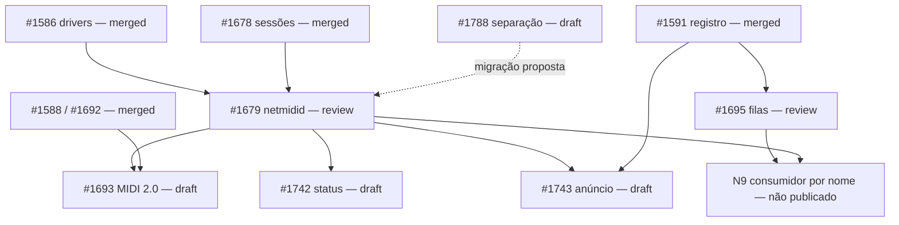

# PRs, dependências e propostas — 2026-10-22

Consulta ao GitHub: **2026-10-22, 07:51 UTC / 04:51 BRT**.
Escopo: PRs de `JJDSNT` contra `aros-development-team/AROS` e as propostas
relacionadas ao driver MIDI de rede e à separação dos componentes.

O [inventário completo](upstream-prs.md) registra **24 PRs merged,
7 abertos e 1 fechado sem merge**. Três abertos estão prontos para
review; quatro são drafts. Todos os sete têm os checks de Codacy, finais
de linha, nomes Windows e mergefreeze aprovados, e estão `MERGEABLE`.
Nenhum dos sete tem review formal ou thread inline nesta consulta.
O comentário recente em #1679 é nosso aviso da refatoração, não um pedido
novo de alteração do mantenedor. Não há um `CHANGES_REQUESTED` a atender
nesses PRs neste momento.

Evidência local da consulta: `build/pr-status-2026-10-22/snapshot.json`
e a consulta de threads no mesmo diretório, ambos ignorados pelo Git.
Upstream consultado: `43e2e698c4`.

## Abertos: situação e bloqueio real

| PR | Situação publicada | Bloqueio atual / próximo passo |
| --- | --- | --- |
| [#1679](https://github.com/aros-development-team/AROS/pull/1679) — netmidid e AppleMIDI | Pronto para review; `60f807ef96` | As dependências originais estão merged; aguarda revisão. A separação #1788 cria uma migração adicional que propusemos e ainda não publicamos neste consumidor. Planejar sua adoção antes de consolidar os dois layouts upstream. |
| [#1693](https://github.com/aros-development-team/AROS/pull/1693) — Network MIDI 2.0 | Draft; `4776ebc8f4` | Depende de #1679; rebase e nova verificação após o merge do pai. #1588 e #1692 já merged. Não depende de mDNS nem de NetMIDIStatus. |
| [#1695](https://github.com/aros-development-team/AROS/pull/1695) — browse/resolve por filas | Pronto para review; `fc4e114e07` | Aguarda revisão da API de eventos e da requisição emprestada discutidas em #1559. Acordo sobre esse contrato ainda não foi registrado por um mantenedor; a proposta concreta está disponível para review. #1591 já merged. |
| [#1735](https://github.com/aros-development-team/AROS/pull/1735) — codec BLE-MIDI | Pronto para review; `3918469bab` | Aguarda revisão. #1507 já merged; não depende dos PRs de rede nem da extensão futura do CAMD. Testes de rádio da classe são uma limitação mais ampla, não uma dependência nova declarada para este ajuste de codec. |
| [#1742](https://github.com/aros-development-team/AROS/pull/1742) — NetMIDIStatus | Draft; `ad4ce857f2` | Depende de #1679, que fornece o serviço e o ABI do snapshot. Depois, rebase, checks e saída de draft. Não depende de #1693 ou #1743. |
| [#1743](https://github.com/aros-development-team/AROS/pull/1743) — anúncio AppleMIDI | Draft; `c1d710e74e` | Depende de #1679. O registro mDNS de #1591 já merged e a validação Avahi passou. Não depende de #1693, #1695 ou #1742. |
| [#1788](https://github.com/aros-development-team/AROS/pull/1788) — separar payload, controle e helpers | Draft; `1687a2173b` | Revisão da divisão e migração coordenada dos consumidores. A biblioteca é baseada em master e não depende de #1679 para compilar; o draft evita publicar a mudança de interfaces sem alinhar o serviço e seus filhos. |

### Dependências publicadas e migração proposta são coisas diferentes

Hoje #1679 usa a biblioteca combinada que #1678 já colocou em master.
Seus três filhos dependem do serviço. #1788 propõe substituir essa divisão
por bibliotecas e headers separados; **o #1788 ainda não está nos quatro
branches publicados do serviço**. O código equivalente e os cortes
atualizados já estão no companion repository.

Assim, #1788 não é um novo pedido de review do mantenedor nem um bloqueio
de compilação do #1679 publicado. É a correção arquitetural que escolhemos
priorizar. Para adotá-la, atualizar os quatro consumidores, compilar e
validar o conjunto e explicitar a dependência. Não há um ciclo técnico
“#1788 depende de #1679 e #1679 depende de #1788”.

## O que os merges já destravaram

- **#1585/#1586/#1587/#1678:** descoberta dos drivers, adapters CAMD,
  payload e sessões já estão upstream. O serviço #1679 não aguarda mais
  nenhum desses PRs.
- **#1588/#1692:** a biblioteca UMP/Network MIDI 2.0 e suas correções de
  identidade estão merged. #1693 agora espera o serviço, não a biblioteca.
- **#1560/#1591, sobre #1543/#1558:** responder e registro DNS-SD estão
  merged sobre o suporte multicast. O anúncio #1743 não aguarda mais
  infraestrutura mDNS; falta o serviço pai.
- **#1676/#1677:** as correções de expunge do CAMD e do worker netinfo
  estão merged. Netinfo não é um bloqueio pendente do serviço.
- **#1730/#1731/#1732/#1733/#1734/#1744:** correções de abertura de portas,
  debugdriver, notificações/scan, USB MIDI, SysEx/ErrFilter e exclusão de
  `.info`/`.dbg` estão merged. A ressalva do scan foi atendida por #1744.
- **#1506/#1507:** a base BLE e a classe MIDI estão merged. O ajuste de
  codec #1735 é um follow-up independente. A remoção da classe antiga
  local já não espera o merge de #1507, mas ainda precisa de auditoria dos
  consumidores e do empacotamento.

Desde a consulta anterior desta sessão não houve outro merge de PR nosso.
O merge mais recente continua sendo #1677, em 2026-10-20 às 14:28:26 UTC.
As 24 entradas merged, inclusive trabalhos anteriores de Bluetooth,
CAMD e llvmpipe, estão no inventário completo.

## Propostas: o que as bloqueia e o que pode avançar

“Pode avançar” abaixo significa preparar código, auditoria ou draft; não
significa que uma mudança de API já foi aceita pelos mantenedores.

| Proposta / backlog | O que a bloqueia agora | Trabalho possível / condição para concluir |
| --- | --- | --- |
| AM-ARCH-01 / AM28 — separar AppleMIDI, RTP-MIDI e helpers | Implementado e validado aqui; revisão de #1788 e migração dos consumidores ainda pendentes upstream. | Atualizar #1679/#1693/#1742/#1743 para a nova divisão e verificar cada diff; coordenar os merges. Não repetir a extração já feita. |
| N9 — descoberta de peers por nome, MD01 | #1695 ainda é proposta de API; o consumidor local ainda usa Hooks e TXT escapado. Não existe um PR N9 pronto que passe a funcionar automaticamente ao mergear #1695. | Pode ser preparado como draft sobre a revisão exata de #1695: consumir filas e TXT binário, preservar nomes completos, refazer assinaturas após restart, tratar overflow e validar com peer independente. Merge depende do contrato de eventos e do serviço. |
| Anúncio Network MIDI 2.0, além do anúncio AppleMIDI | #1743 cobre somente AppleMIDI. O transporte #1693 e a integração de anúncio ainda precisam compor uma proposta própria. | Preparar depois da base do serviço/MIDI 2.0 e dos cortes correspondentes; registro usa #1591 já merged. Não confundir anunciar com descobrir peers; anunciar não exige #1695. |
| UP12 — uma fonte comum das regras UMP | Auditar a duplicação real entre o codec e a implementação/protótipos CAMD atuais; decidir onde ficará a API compartilhada. Não há aceite registrado de um novo local/API comum. | Comparar tabelas e validações, definir o menor contrato reutilizável, propor a localização aos mantenedores. UMP deve servir USB, rede e CAMD sem depender de um transporte. |
| UP16 — dar um local próprio aos fontes UMP | Depende da decisão de propriedade de UP12. | Preparar um plano de movimento e consumidores; não colocar UMP em `network/` apenas porque a rede o utiliza. |
| NM19 — mover Network MIDI 2.0 de `src/` para `network/netmidi2/` | Nenhum PR aberto é pré-requisito técnico para o movimento no companion repository; evitar misturar a reorganização com a migração #1788 ainda em review. | Pode avançar isoladamente, com atualização de builds/cortes e testes. É organização dos fontes; namespace público já é próprio. |
| L11 — concluída em 2026-10-22 | Removidos a classe BLE antiga, o programa manual e o codec duplicado. O pacote depende da classe AROS; Preferences usa suas portas e os testes compilam seu codec. | L10 continua apenas para a consulta dispositivo/porta. Builds x64/m68k e testes host passaram; rádio e build integral em upstream limpo ainda precisam de validação. Ver [BLE](ble-midi.md) e [política de fontes](upstream-source-policy.md). |
| B29/B30/B31 — identidade, presença e nomes por porta CAMD | Ainda dependem de desenho/contrato de extensão acordado com mantenedores. O merge da classe #1507 não é aceite automático desse bloco opcional. | Preparar proposta ABI e comportamento com drivers legados; comprovar identidade estável sem alterar nomes de clusters ou `MidiDeviceData` existente. |
| B32 — UMP e timestamps pela fronteira do driver | Depende da extensão acima e dos gates de especificação/compatibilidade CAMD. | Pode haver desenho e testes preparatórios; não é requisito para o primeiro driver de rede funcional em MIDI 1.0. Essa limitação já foi aceita para a primeira etapa. |
| Drivers residentes em memória — [issue #1736](https://github.com/aros-development-team/AROS/issues/1736) | Issue aberta, sem comentário de mantenedor. Contrato de retenção da classe, remoção com portas em uso e fallback por arquivo ainda precisa ser definido. | Proposta de desenho antes de implementar nova API pública. #1732/#1744 melhoram o scan por arquivo; não implementam registro residente. Não confundir esta proposta com o bloco de metadados B29–B32. |
| Synth como serviço independente CAMD/AHI | O executável independente já existe; faltam controle/lifecycle e validação de áudio AHI nativo. | Consolidar start/stop/reload, fallback de banco e liberação de recursos. Pesquisa de referências não é port pronto. Plugins e um novo host/library não são pré-requisitos. |
| Agrupar headers de configuração por transporte | Sugestão de organização, sem defeito funcional demonstrado nem PR aberto. As opções atuais são do runtime/arquivo, não da biblioteca do protocolo. | Se adotado, manter no âmbito de `netmidi`/transports e atualizar includes/cortes. Não mover parsers de arquivo ou reservas CAMD para a API pública AppleMIDI. |

### Discussões que continuam abertas

- [#1559](https://github.com/aros-development-team/AROS/issues/1559): o
  último comentário, em 2026-10-19, é nosso detalhamento da fila e do
  wakeup de #1695. Não há resposta nova de mantenedor. A infraestrutura
  já merged não equivale a aceite da API completa de browse/resolve.
- [#1736](https://github.com/aros-development-team/AROS/issues/1736):
  proposta de driver residente aberta em 2026-10-20, sem comentários.

## Ordem de trabalho para chegar ao driver de rede

1. Revisar #1788 e alinhar a migração dos quatro branches consumidores.
   A separação e os testes já existem aqui; esta é a pendência de
   integração/publicação, não uma nova implementação de protocolo.
2. Concluir review/merge de #1679. Ele é o gargalo compartilhado por
   #1693, #1742 e #1743; nenhum novo merge já ocorrido libera esses drafts.
3. Após o pai, rebase e checks dos três filhos; eles não precisam esperar
   uns pelos outros. O driver AppleMIDI por IPv4 não precisa aguardar
   browse/resolve nem futuras extensões CAMD.
4. Em paralelo, review de #1695 e #1735, ambos independentes do merge de
   #1679. Preparar N9 como dependente da API proposta, sem prometer
   descoberta por nome só porque #1695 mergeou.
5. Deixar UMP compartilhado, remoção da cópia BLE, driver residente e
   reorganizações de diretório como propostas próprias. Não torná-las
   pré-requisitos artificiais do primeiro caminho MIDI 1.0 funcional.

## Divergências encontradas na documentação

O corpo publicado de #1693 ainda contém uma frase antiga dizendo que
#1677/netinfo está aberto. É informação desatualizada: #1677 está merged.
Esta consulta registra o fato correto sem alterar branches ou postar
comentários. Os grafos de 2026-10-12 e os relatos históricos dos backlogs
também preservam pré-requisitos já satisfeitos; esta seção e o inventário
datado prevalecem para o planejamento atual.
