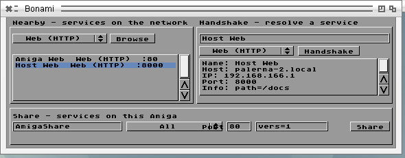

# Bonami for AROS

A system-wide mDNS/DNS-SD service for AROS, ported from
[amigazen Bonami](https://github.com/amigazen/Bonami) at the revision pinned
in `../bonami`. The sources keep Bonami's BSD 2-Clause license and are copied
here so that the port can be built and reviewed without a nested checkout.

State on 2026-10-11: it runs on Linux-hosted AROS (x86-64), where
`tools/bonami-hosted.sh` checks it against Avahi in 24 ways. It compiles for
amiga-m68k and raspi-aarch64 and has not been run there.

## What is here

| Path | What it is |
|---|---|
| `src/mdnsd*.c`, `src/mdns_*.c` | `mdnsd`, the daemon: the host's one responder and browser |
| `src/bonami_*.c`, `bonami.conf` | `bonami.library`, the client library with Bonami's ABI |
| `include/` | public headers: `<bonami/mdns.h>`, `<bonami/nipc.h>`, `<libraries/bonamibase.h>` |
| `services.d/mdns` | the AROSTCP service manager's entry for the daemon |
| `tools/` | `Nearby`, `Handshake`, `Share`, `dnssd` |
| `commodity/` | `Bonami`, the GadTools commodity |

`ports/aros/mdns_probe.c` in the repository's root builds `BonamiProbe`, the
program the test drives.

## How it fits together

```text
application ── bonami.library ──┐
application ── bonami.library ──┼── message port "BonAmi" ── mdnsd ── bsdsocket.library
tools, commodity ───────────────┘                              │
                                                    one UDP 5353 socket
                                                    for each interface
```

Upstream Bonami runs its engine as a task inside the library, started by the
first caller and stopped by the last. On AROS the engine is a daemon:

- **mdnsd** is started by the AROSTCP service manager from
  `db/services.d/mdns` and registers with `netservices.library`. Around a
  reconfiguration of the stack it says goodbye for what it announced, lets go
  of `bsdsocket.library`, and afterwards takes it up again with what the
  applications had registered. It installs in `SYS:System/Network/Services`.
  Started by hand it runs unmanaged until Ctrl-C.
- **bonami.library** holds no mDNS state and does not open
  `bsdsocket.library`. Every call is a message to mdnsd's public port and
  waits for the reply. Without mdnsd a call returns `MDNSERR_NOENGINE`.

A registration, browse, query or inquiry belongs to the task that made it.
It ends when the task withdraws it, calls `CloseMDNSEngine()`, or closes the
library for the last time. `CloseMDNSEngine()` therefore no longer stops the
engine for other callers. A task that ends without closing the library is
found by mdnsd within about five seconds, which compares the owners with the
system's task lists; a new task that starts at the same address as the dead
one is taken for it.

A hook given to the library is called in mdnsd's process, as upstream calls
it in `mdns.task`. It may only copy what it is given and signal its own
task; it must not print or call the library.

## Building

From an AROS build tree with this repository linked into `contrib/extras`:

```sh
make contrib-aros-midihub-bonami contrib-aros-midihub-mdnsd
make contrib-aros-midihub-mdnstools contrib-aros-midihub-mdnscx
make contrib-aros-midihub-mdnsprobe
```

The AROS tree needs the patches in `patches/net/series`; see
`patches/README.md`. Without them AROSTCP delivers no IPv4 multicast on a
SANA-II interface.

The library and the daemon install where the system looks for them. The
tools, the commodity and the probe install in `Extras/aros-midihub/C` while
this is incubating.

## The network side

mdnsd has one socket for each interface that is up, can multicast and has an
IPv4 address, bound to it with `SO_BINDTODEVICE`. It looks at the stack's
interfaces every three seconds: one that appears gets a socket, one that
disappears or changes its address loses it, and after any change the host's
records are announced again.

- What is heard on a link is answered on that link.
- An address record carries the address of the interface it is sent on.
- A host reachable over two links has an address on each. The one heard first
  is kept while its link is there, so that a browse is not told a new address
  with every answer.
- mdnsd does not receive what it sends (multicast loopback is off) and ignores
  any packet from one of the host's own addresses.

Of RFC 6762 and RFC 6763 it does this much:

- A service name is probed three times, 250 ms apart, and then announced
  twice. If another host answers for it, the service becomes "Name (2)",
  "Name (3)" and so on and is probed again. The same happens when another
  host later sends an SRV or TXT record for a name already announced.
- It answers PTR questions for a type, SRV, TXT and ANY questions for an
  instance, A questions for the host, and the `_services._dns-sd._udp`
  enumeration. A PTR record the asker lists as known is not sent again.
- PTR and TXT records live 75 minutes, SRV and address records two. A
  service that is withdrawn, and everything when mdnsd stops, gets a goodbye.
- A service's text is `key=value` pairs separated by spaces; each pair is
  sent as a TXT string of its own, and the strings of a received record are
  joined the same way.
- What other hosts announce is kept for the time their PTR record gives and
  dropped on a goodbye. A browse that starts later is told what is known.
- A browse asks after 1, 2, 4... seconds and then once a minute, the first
  time allowing a unicast answer. An instance known only by its PTR record
  is asked for the rest, and a host without a known address for its address.

Internally an address is a number (`0xAABBCCDD` is A.B.C.D), converted with
`htonl()`/`ntohl()` where it meets a socket call or the public API, and DNS
fields are written byte by byte. The same source is right on either byte
order; upstream's was only right on a big-endian machine.

## API

The library keeps Bonami's functions at their offsets. `RegisterServiceA()`
returns before the name has been probed, so a client is not told the name its
service finally got; a browse is.

`UpdateServiceA(ref, tags)` changes the text (`MDNS_TXTRecord`) or the port
(`MDNS_Port`) of a registered service; a tag that is not given leaves its
value alone. `StopResolve()` does nothing, because `ResolveServiceA()` answers
at once from what is known, or returns `MDNSERR_NOTFOUND` and asks the link,
so that a caller tries again.

### Additions

The AROS library is version 40.2 and adds, after Bonami's functions:

| Addition | What it does |
|---|---|
| `LookupHostA(host, &addr, tags)` | Waits for a host's IPv4 address, at most `MDNS_Timeout` seconds (default 3). `addr` is in network byte order. A name without a dot is taken in `.local`. This host's own name is answered without asking. |
| `QueryRecordA(name, rrtype, hook, tags)`, `StopQuery(ref)` | A standing question for any record. Each answer goes to the hook as a `struct MDNSRecordMsg`; names inside PTR and SRV data are written out in full. |
| `MDNS_HostName` with `MDNS_HostAddr` in `RegisterServiceA()` | Registers a service for another host, which need not speak mDNS itself. |

They close the three "dns-sd feature gaps" of Bonami's `TODO.md` and are
meant to be offered to Bonami, not to stay an AROS dialect.

### Envoy bridge

Bonami's three Envoy entry points work, on Bonami's side:

- `PublishNIPCEntitiesA(tags)` announces this host as one instance of
  `_envoy-nipc._tcp`, named after the host, on port 376 unless
  `MDNS_NIPC_Port` says otherwise. Its TXT record lists `MDNS_NIPC_Entity`,
  `MDNS_NIPC_Service` and `MDNS_NIPC_Owner` as `entity=`, `service=` and
  `owner=`. A task has one publication; a second call replaces it, and
  `UnpublishNIPCEntitiesA()` or the task's last close withdraws it.
- `InquiryFromNIPCTagsA(hook, maxTime, maxResponses, tags)` takes the tags of
  `NIPCInquiryA()`. It matches `MATCH_ENTITY`, `MATCH_SERVICE`, `MATCH_OWNER`,
  `MATCH_HOSTNAME` and `MATCH_IPADDR` and answers `QUERY_HOSTNAME`,
  `QUERY_IPADDR`, `QUERY_ENTITY`, `QUERY_SERVICE` and `QUERY_OWNER`. Each host
  answers once. The hook is called as `nipc.library` calls it: a tag list for
  each host, a zero return ends the inquiry, and a last call with NULL comes
  at the response limit or when the time is up. A `maxTime` of zero gives up
  the oldest inquiry with that hook.

mdnsd repeats the Envoy tag values instead of including `<envoy/nipc.h>`, so
it builds and runs without Envoy. AROS's `nipc.library` does not call these
functions; `docs/nipc-envoy-future.md` says how the two could be joined.

## Tools and commodity

`tools/` holds Bonami's command-line front ends, ported from `SDK/Examples`:

- `Nearby [TYPE] [ALL] [TIME n] [RAW] [PORTS]` lists the kinds of service on
  the network, or the instances of one kind.
- `Handshake NAME TYPE [TIME n]` resolves one instance.
- `Share NAME TYPE PORT [TEXT...] [QUIET]` announces a service until Ctrl-C.
- `dnssd` follows Apple's `dns-sd`: `-B`, `-L`, `-R`, `-Z`, `-E`, `-F`, `-V`,
  and, through the additions above, `-P` (register for another host), `-q`
  (ask for any record) and `-G v4` (look up a host).

A type may be a plain word (`web`, `printer`, `ssh`...) or a DNS-SD type. In
the shell a `key=value` argument needs quotes (`Share Name web 80 "path=/"`),
because `ReadArgs()` otherwise takes the `=` as a separator.

`commodity/` holds `Bonami`, the GadTools commodity with Nearby, Handshake
and Share in one window, opened with `CX_POPUP=YES`, from Exchange, or with
Ctrl-Alt-N.



What changed in these for AROS is small and in one place, `tools/ba_common.h`:
hooks are declared with `BA_HOOK()`, formatted output goes through
`VNewRawDoFmt()`, and an address is printed byte by byte. In the commodity
the AROS startup code opens the libraries, and the values GadTools writes
through a pointer are `IPTR`.

## Testing

`tools/bonami-hosted.sh` boots Linux-hosted AROS on two veth links with the
host's Avahi on the other end of both, and checks 24 things:

- each side resolves the other's service, on both links, with each link's
  address;
- an interface's address changes and the next service is announced with the
  new one, while the other interface keeps its own;
- a program that only closes the library has its service withdrawn; a task
  that ends without closing it has its service withdrawn by mdnsd;
- a name the host already has is taken as "Name (2)", and a name another
  host claims after it was announced is given up the same way;
- `UpdateServiceA()` changes a text; `Share`, `Nearby`, `Handshake` and
  `dnssd -P`, `-G`, `-q` do their part, and `Share` says goodbye on Ctrl-C;
- the Envoy bridge publishes this host and finds the host that has an entity.

It needs passwordless sudo, a running `avahi-daemon`, `avahi-utils`,
`ethtool` and `xvfb-run`.

The commodity has no automatic test. It was driven by hand on hosted AROS:
the list of kinds, the instances of one kind from this host and from Avahi,
and a Handshake that filled in host, address, port and text. Its Share panel,
its hot key and Exchange were not tried.

Nothing here has been run on m68k or AArch64, against Apple's Bonjour, or
between two AROS systems.

## Known limits

Protocol:

- The host's name is a record of its own: probed when the network comes
  up, announced, answered for whether or not a service is registered, and
  changed to `name-2`, `name-3` when another host has it, with the
  services pointing at the new name (`tools/mdns-hostname-hosted.sh`).
  Not tested: losing the name after it was announced, and the tie-break
  for two hosts probing the same host name at once; both are implemented.
  The number is not remembered across a restart of mdnsd.
- Two hosts that probe the same service name at the same moment are told
  apart by the tie-break of RFC 6762 section 8.2: the one whose SRV record
  sorts earlier waits a second and probes again
  (`tools/mdns-tiebreak-hosted.sh`). mdnsd proposes the SRV record only,
  not the TXT record beside it.
- A browse question lists the answers mdnsd already has, each with more
  than half its life to go (`tools/mdns-known-answers-hosted.sh`). What
  does not fit into one 1400-byte packet is left out rather than sent in a
  second packet with the truncation bit, and only browse questions do it.
- mdnsd's answers are sent at once rather than delayed and gathered.
- IPv4 only.
- At most eight interfaces. An address that changes is noticed within three
  seconds, not at once.

Library and daemon:

- A client is not told the final name of its service.
- A question about one of this host's own services gets no answer through
  `QueryRecordA()`, since mdnsd does not hear itself.
- A value in a service's text cannot contain a space, and the whole text is
  at most 256 characters.
- The Envoy bridge is not matched or answered for what DNS-SD cannot tell
  (memory, versions, realms).

Tools and commodity:

- In the commodity's Share row the "Port" label overlaps the kind gadget
  with AROS's default font; the layout uses the original's fixed positions.

License:

- Bonami is BSD 2-Clause. `<libraries/netservice.h>`, which only
  `src/mdnsd_service.c` includes, carried a GNU GPL version 2 banner until
  AROS commit `43328bc8f2` (2026-10-11) gave it the plain AROS notice of a
  public SDK header. With that, and `95ed7cd53c` for the BSD-derived
  network headers, nothing the port includes is under the GPL, and the
  question that was to be settled before going upstream is closed. Build
  against AROS at `51bffe65a4` or later.
